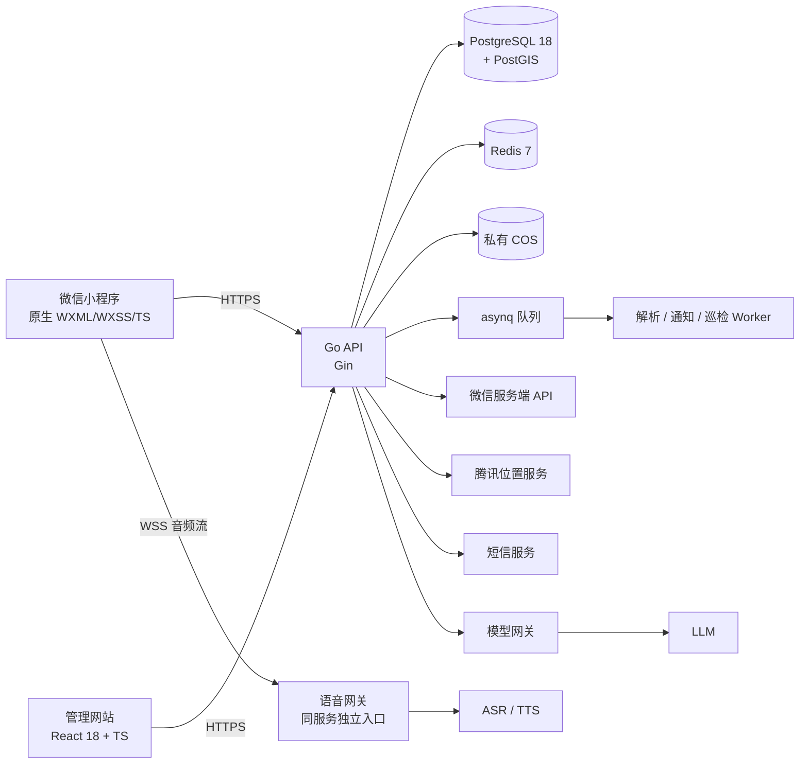

# 房屋中介小程序 · 技术方案（评审稿）

> 版本：v0.1  
> 日期：2026-11-20  
> 状态：**仅方案，不含代码**。评审通过后再进入开发。  
> 范围：微信小程序（房东 / 租客）+ 管理网站（运营 / 审核）+ Go 后端 + PostgreSQL。

---

## 0. 一页结论

| # | 需求 | 结论 | 推荐技术路径 | 必须先知道的限制 |
|---|---|---|---|---|
| 1 | 语音双工推荐 | ⚠️ 可做，但建议定义为“准双工” | 16k PCM 录音 + WebSocket 流式 ASR + LLM 工具调用 + 句级 TTS；播放中可打断 | 微信小程序不提供可靠的原生全双工回声消除；“同时说和听”不做硬承诺 |
| 2 | Word / Excel 自动入库 | ✅ 可行 | 小程序选文件上传 → 病毒扫描 → 解析 → 字段映射 → 地理编码 → 自动入库/待确认 | 首版支持 `.docx` / `.xlsx`；`.doc` / `.xls` 需转换或引导另存 |
| 3 | 登录、手机号、姓氏、角色 | ✅ 可行 | `wx.login` + 手机号快速验证组件 + 姓氏/角色表单 | 手机号能力仅对**非个人、已认证**小程序开放；必须用户主动点按钮 |
| 4 | 租客确认后微信通知房东 | ⚠️ 部分可行 | 小程序订阅消息 + 站内信 + 短信兜底 | 微信不提供用户微信号；订阅消息需房东事先订阅，不能保证“任意时刻直达” |
| 5 | 本市租房地图、数量、缩放限制 | ✅ 可行 | 微信 `map` + 腾讯位置服务 + PostGIS 空间查询 + 服务端聚合 | 公开位置只到区/街道，不能展示小区门牌；缩放级别需真机校准 |
| 6 | 房源弹窗、联系确认、展示房东联系方式 | ✅ 可行 | 底部弹层 + 二次确认 + 联系请求 + 通知 + 授权后展示 | 公开详情只展示区/街道；房东联系方式需授权，建议虚拟号/脱敏 |
| 7 | 自动读取房东朋友圈并巡检 | ❌ 原样不可行 | 改为“30 天到期询问表单 + 手动分享朋友圈 + 自动转 stale” | 微信没有读取个人朋友圈的开放接口；爬取/模拟登录违反平台规则 |
| 8 | 小程序 + 管理网站 + 高数据安全 | ✅ 可行 | 模块化单体：Go + PostgreSQL + Redis + 私有 COS；管理站 React | 安全是体系工程，需资质、流程、审计、备份、渗透测试一起做 |
| 9 | 先方案、后代码 | ✅ 本文 | 评审通过后按 M0–M6 小步实施 | 本文不创建代码、不建表、不接第三方 |

### 0.1 六个必须先拍板的问题

1. **“双工”是产品语义还是通信语义？** 建议接受“可随时打断的准双工”，不承诺真全双工。
2. **朋友圈自动读取做不了。** 是否接受“到期询问 + 一键生成朋友圈文案/海报 + 手动分享”的替代？
3. **微信通知不是无条件的。** 是否接受“订阅消息 + 站内信 + 短信兜底”，并接受房东未订阅时可能只收到站内信？
4. **“哪个微信”无法拿到微信号。** 是否接受“姓氏 + 微信昵称/头像（用户授权）+ 脱敏手机号”？
5. **房东联系方式是否直接明文展示？** 建议默认虚拟号/脱敏，房东授权后才展示；否则易被中介爬取。
6. **文档导入是否允许自动上架？** 建议“自动入库为待发布 + 高置信度自动上架”，避免错误房源直接对外。

---

## 1. 范围、假设与不做的事

### 1.1 MVP 范围

- 单城市起步（可配置切换城市），地图展示该市在租房源。
- 租客：地图找房、语音找房、房源详情、确认联系房东、消息中心。
- 房东：微信登录、上传 Word/Excel、房源管理、接收联系提醒、房源到期确认。
- 管理网站：用户/房东/房源/导入任务/联系记录/通知/巡检/审计/风控。
- 后端：认证、房源、地图聚合、文件导入、联系请求、通知、巡检、审计。

### 1.2 首版不做

- 在线签约、在线支付租金/押金、贷款、产权核验。
- 身份证实名认证、人脸识别（可作为二期增强）。
- 站内即时聊天、音视频看房。
- 多城市同时运营、加盟商体系、分佣结算。
- 自动读取个人微信朋友圈、自动加好友、群发。

### 1.3 容量假设

| 指标 | 首年假设 |
|---|---|
| 日活 | 1,000 |
| 峰值并发 | 50 |
| 在租房源 | 10,000 |
| 图片 | 100,000 张，约 30–50 GB |
| 房东/租客用户 | 20,000 |
| 日联系请求 | 200 |
| 日语音对话 | 1,000 轮 |

结论：**不需要微服务**。模块化单体 + 一个异步 Worker 足够，重点是隔离、审计和备份。

---

## 2. 总体架构



### 2.1 技术选型

| 层 | 选型 | 说明 |
|---|---|---|
| 小程序 | **微信原生** WXML/WXSS/TypeScript | 地图、录音、手机号、文件选择都是微信原生能力；不引 Taro，减少构建链和兼容风险 |
| 管理网站 | React 18 + TypeScript + Vite + **HashRouter** | 与现有前端规范一致；TanStack Query 管服务端数据，Zustand 管少量客户端状态 |
| 后端 | Go 1.24+ / Gin | 分层：handler → service → repository；事务只在 service |
| 数据库 | PostgreSQL 18 + PostGIS | 空间索引、事务、行级约束；金额用整数分 |
| 数据访问 | pgx v5 + 手写 SQL | 全部参数化；不引 GORM |
| 缓存/队列 | Redis 7 + asynq | 验证码/会话/限流/地图短缓存；解析、通知、巡检走队列 |
| 对象存储 | 腾讯云 COS 私有桶 | 预签名 URL；原图不公开；图片脱敏、压缩、审核 |
| 接口契约 | OpenAPI 3.1 | 先改 yaml，再改实现；两端生成类型 |
| 部署 | 腾讯云 CVM/容器 + CLB + WAF + 托管 PG/Redis | 与微信生态近，LBS/ASR/TTS/短信/CMS 一家接通 |

> 说明：现有规范里的 React/Capacitor 约束针对桌面/移动 App 壳；微信小程序是独立宿主，Capacitor 不能打包成小程序。因此小程序用原生，管理站仍用 React；不引入 Taro，避免多一层运行时和兼容风险。

### 2.2 为什么不用微服务/云开发

- 数据少、并发低，微服务只会增加故障面和运维成本。
- 云开发数据库锁定强、复杂空间查询和审计能力弱，不适合“高数据安全”要求。
- 采用**模块化单体**：一个 API 进程 + 一个 Worker 进程；语音网关作为同一代码库的独立 WS 入口，后续可拆。

### 2.3 代码仓库结构（建议）

```text
housing/
├── miniprogram/             微信原生小程序
├── admin-web/               React 管理网站
├── server/
│   ├── cmd/api/
│   ├── cmd/worker/
│   ├── internal/
│   │   ├── auth/            登录、手机号、JWT
│   │   ├── user/            用户、房东/租客资料
│   │   ├── property/        房源、图片、状态
│   │   ├── geo/             地图聚合、地理编码
│   │   ├── importer/        Word/Excel 解析
│   │   ├── contact/         联系请求、联系方式解锁
│   │   ├── notify/          订阅消息、站内信、短信
│   │   ├── freshness/       30 天巡检
│   │   ├── admin/           管理站接口
│   │   ├── audit/           审计日志
│   │   ├── modelgw/         LLM/ASR/TTS 网关
│   │   └── storage/         COS
│   └── migrations/
├── api/openapi.yaml
├── deploy/
└── docs/
```

### 2.4 工程约束

- handler → service → repository，禁止跨层；事务只在 service 层开；`context.Context` 一路向下传。
- 迁移只新增、不改历史；每次迁移可回滚或至少有前滚预案。
- 先改 `api/openapi.yaml`，再改实现；两端类型生成，不手写重复类型。
- 客户端不存密钥；日志不打印手机号、Token、地址正文、文档内容。
- 小步提交：每个可运行改动单独提交；不一次生成整个模块。

---

## 3. 需求逐项设计

### 3.1 语音找房（需求 1）

#### 3.1.1 交互定义

首版按“**准双工**”设计，产品上表现为：

- 用户点麦克风后进入连续对话，不用每轮重复点击。
- 系统说话时，用户可以直接开口打断；系统在 300–800 ms 内停止 TTS，转为倾听。
- 一轮结束后自动继续听，直到用户说“结束/退出”或静音超时。

不承诺“像打电话一样同时说和听”。原因：微信小程序没有稳定的原生 AEC（回声消除）能力，`RecorderManager` 与 `InnerAudioContext` 在不同机型上的音频焦点行为不一致；真全双工需要 RTC/原生插件，成本和审核风险都高。

准双工也必须在 iOS/Android 真机矩阵验证“播放时仍能录音”。若系统抢占音频焦点导致录音暂停，则退化为“点一下打断/半双工”，不影响主流程可用。

#### 3.1.2 技术链路

```text
小程序录音 16kHz / 单声道 / PCM
  → WSS 二进制帧（每帧 2–4 KB）
  → 服务端 VAD + 流式 ASR（partial/final）
  → LLM 意图识别 + 工具调用（search_properties）
  → 结构化查询 PostgreSQL/PostGIS
  → LLM 生成口语化回答（只允许引用查询结果）
  → 句级 TTS 音频 URL
  → 小程序顺序播放；用户插话则停止播放并取消当前请求
```

关键参数：

| 项 | 建议值 |
|---|---|
| 采样率 | 16,000 Hz |
| 声道 | 单声道 |
| 格式 | PCM（`RecorderManager` 支持 `format: 'PCM'` 和 `onFrameRecorded`） |
| 帧大小 | 2–4 KB |
| VAD | 服务端能量 + 静音时长；首版 600 ms 静音断句 |
| ASR | 腾讯云实时语音识别，走 `modelgw` 的 speech 路由 |
| TTS | 句级合成，单句 ≤ 60 字；首版不做音频流式 |
| 首包目标 | 用户说完到第一句语音 ≤ 2.5 s（p95） |

#### 3.1.3 意图与槽位

```text
intent: search_property | refine_search | contact_landlord |
        publish_property | freshness_check | chitchat | exit

slots:
  city, district, street, community,
  budgetMin, budgetMax, layout, areaMin, areaMax,
  orientation, floor, tags, commuteTo, pets
```

规则：

- LLM 只做“理解”和“组织语言”，**房源事实必须来自数据库工具结果**。
- 工具返回空结果时，回答“这个条件下暂时没有”，并建议放宽一个条件；禁止编造房源。
- 不在 Prompt 中放手机号、微信昵称、完整地址；只放区/街道和房源公开字段。
- 用户说“联系房东”时，不直接播报联系方式，转入确认流程。

#### 3.1.4 降级策略

| 故障 | 降级 |
|---|---|
| ASR 超时/失败 | 提示“没听清”，保留文字输入；可重试一次 |
| LLM 超时 | 退化为规则解析 + 关键词搜索 |
| TTS 失败 | 只展示文字卡片，不阻断流程 |
| 弱网 | 录音改为 3–8 秒短段上传，非流式 |
| 用户拒绝麦克风 | 全程文字输入，功能不缺失 |

### 3.2 Word / Excel 自动入库（需求 2）

#### 3.2.1 支持格式

| 格式 | 首版 | 处理方式 |
|---|---|---|
| `.docx` | ✅ | 标准库 `archive/zip` + `encoding/xml` 解析段落、表格、内嵌图片，避免商业文档库授权风险 |
| `.xlsx` | ✅ | `excelize`（BSD-3）读取单元格、合并单元格、图片 |
| `.doc` | ⚠️ | 提示另存为 `.docx`；或服务端 LibreOffice 沙箱转换（二期） |
| `.xls` | ⚠️ | 提示另存为 `.xlsx`；或服务端转换（二期） |
| `.docm` / `.xlsm` | ❌ | 含宏，直接拒绝 |
| PDF / 图片 | ❌ | 首版不做；避免 OCR 误差和审核风险 |

> 新增依赖仅建议 `excelize`（BSD-3，用于 xlsx 解析）；`.docx` 用标准库。正式引入前按规范单独确认。

#### 3.2.2 上传与解析流程

```text
房东点“上传房源文档”
  → wx.chooseMessageFile（从聊天记录选文件）
  → 上传到 API（≤20 MB）
  → MIME 嗅探 + 扩展名双校验 + 病毒扫描
  → 入 asynq 解析队列
  → 解析正文/表格/图片
  → 字段映射（规则优先，LLM 兜底）
  → 地址地理编码（区/街道/小区）
  → 校验（面积、租金、户型、必填项）
  → 生成 properties（status=draft）+ 错误行报告
  → 房东确认 / 高置信度自动上架
```

#### 3.2.3 字段映射

| 标准字段 | 常见表头同义词 |
|---|---|
| 小区/社区 | 小区、楼盘、项目、社区、地址 |
| 区 | 区、区域、行政区、城区 |
| 街道 | 街道、片区、商圈、板块 |
| 面积 | 面积、建筑面积、㎡、平米 |
| 租金 | 租金、价格、月租、元/月 |
| 户型 | 户型、房型、几室几厅 |
| 朝向 | 朝向、方向 |
| 楼层 | 楼层、所在层、总层 |
| 图片 | 图片、照片、实拍 |

规则：

- 表头同义词表 + 列类型推断；无法确定时调用 LLM 做“列名 → 标准字段”映射，返回 JSON Schema 约束。
- 多行 Excel：每行一套房源；合并单元格向下填充。
- Word：优先解析表格；没有表格时按“字段名：值”段落解析；支持一个文档多套房源。
- 图片：Excel 内嵌图片按锚点行匹配；Word 图片按出现顺序匹配；匹配不上则进入待补图。
- 地址用于地理编码和内部匹配；**公开展示只到“区/街道”**，小区名和门牌不对外；完整地址写入加密字段，仅房东和管理员（审计后）可见。

#### 3.2.4 校验与入库策略

| 校验 | 处理 |
|---|---|
| 面积 5–1000 ㎡ | 超出标为错误行 |
| 月租 100–1,000,000 元 | 超出标为错误行 |
| 区/街道必须属于当前城市 | 不通过则要求人工选择 |
| 小区无法地理编码 | 降级到街道中心点，标记 `precision=street` |
| 重复房源 | 房东 + 小区 + 面积 + 租金 + 户型 模糊去重 |
| 图片缺失 | 允许先入库，标记“待补图”，不自动上架 |

入库策略建议：

- 默认 `draft`（待发布），房东在结果页一键确认。
- 置信度高（字段齐全、地理编码成功、无重复、至少 1 张图）且房东开启“自动上架”时，直接 `active`。
- 管理站可配置“自动上架”开关；出问题可一键下架并追溯导入任务。

#### 3.2.5 文件安全

- 只接受白名单 MIME；扩展名与文件头不一致直接拒绝。
- 限制 20 MB、单文件 500 行、100 张图；解析超时 60 s、内存上限 512 MB。
- 防 ZIP 炸弹、XML 实体膨胀；不执行宏、不执行公式、不调用外部链接。
- 原文件加密存储，**7 天后自动删除**；只保留解析后的结构化数据和必要的错误报告。
- 错误报告导出 Excel 时防公式注入（以 `'` 前缀处理 `= + - @`）。

### 3.3 登录、手机号、姓氏、角色（需求 3）

#### 3.3.1 触发时机

- 浏览地图、看房源详情：**不强制登录**。
- 点“联系房东”、发布房源、查看消息、房东管理：强制登录。
- 未登录时弹出登录页/半屏弹层；登录成功后回到原来的动作，不丢上下文。

#### 3.3.2 流程

```text
1. 小程序启动静默 wx.login → code
2. 后端 code2Session → openid / unionid，签发短 token
3. 用户点“联系房东” → 检查 /me：
   - 无 token / 过期 → 登录页
   - 有 token 但未填手机号/姓氏/角色 → 资料页
4. 资料页：
   - 手机号：<button open-type="getPhoneNumber">，用户主动点击
   - 后端用 code 调微信 getPhoneNumber，立即加密存储
   - 姓氏：1–10 个字符，允许复姓
   - 角色：房东 / 租赁方（租客），二选一
   - 勾选《隐私政策》和《用户协议》
5. 提交 → 后端校验 → 完成资料 → 回到原动作
```

要点：

- 手机号能力仅对**非个人、已认证**小程序开放；上线前必须确认主体资质。
- 接入微信隐私保护指引：首次调用手机号、位置、录音前，用 `wx.requirePrivacyAuthorize` 或隐私弹窗取得同意；隐私政策列明第三方 SDK。
- 不调用 `wx.getUserProfile` 强拉头像昵称；头像用 `chooseAvatar`，昵称让用户自己填，且都可跳过。
- 手机号用 AES-256-GCM 加密存储；另存 HMAC-SHA256 哈希用于唯一性校验和查询；列表只展示 `138****1234`。
- 角色首版不允许用户随意切换；切换需走管理站审核，避免房东/租客身份混乱。
- 微信 `access_token` 由后端统一缓存/刷新，禁止下发客户端；与小程序用户 token 分开管理。
- Token：access 15 分钟、refresh 30 天，刷新时轮换；refresh 只存服务端哈希；敏感操作要求重新 `wx.login` 校验。
- 账号注销：15 天冷静期；删除/匿名化个人资料，保留必要的交易/审计记录。

### 3.4 通知房东（需求 4）

#### 3.4.1 先纠正一个事实

微信小程序**拿不到用户的微信号**。登录只返回 `openid` / `unionid`；昵称和头像也需要用户主动授权。因此“提示是哪个微信”只能做到：

- 姓氏；
- 用户授权后的微信昵称/头像；
- 脱敏手机号；
- 房源标题、时间。

如果业务坚持“必须显示微信号”，只能让用户**手动填写微信号**，且不能保证真实。

另外，小程序不能直接向房东发送“微信联系人名片”；只能通过订阅消息/站内信发送固定模板字段，或让房东在小程序内查看联系记录。

#### 3.4.2 通知渠道

| 渠道 | 能力 | 限制 | 首版 |
|---|---|---|---|
| 小程序订阅消息 | 服务通知里直达，可跳小程序 | 需用户事先订阅；一次性订阅发一条消耗一次；长期订阅仅限政务/医疗/交通/金融/教育等类目 | ✅ 主渠道 |
| 站内信 | 一定可达，登录可见 | 无微信推送 | ✅ 必做 |
| 公众号模板消息 | 可多次触达 | 需认证服务号、用户关注、unionid 绑定 | ⚠️ 二期 |
| 短信 | 可达 | 有成本；内容需合规；易被拦截 | ✅ 兜底 |

> 房地产/房屋中介不属于长期订阅消息的开放类目，不能假设“订阅一次、永久推送”。房东每次发布/确认房源时，应引导其订阅“租客联系提醒”；未订阅时走站内信 + 短信。

#### 3.4.3 联系流程

```text
租客点“联系房东”
  → 登录/资料校验
  → 弹出确认框：
     标题：确定需要联系房东吗？
     按钮：放弃 / 确认
  → 确认：
      POST /v1/contact-requests（幂等键）
      服务端校验房源在租、租客手机号、频率限制
      写 contact_requests + notification_outbox
      异步发送：订阅消息 → 站内信 → 短信（按开关降级）
      返回房东联系方式（按房东授权范围）
  → 展示房东微信/电话，提供“拨打/复制”
  → 全程写 audit_logs
```

通知内容建议（按订阅消息模板字段裁剪，不发送长文本）：

```text
房源：{区/街道} · {面积}㎡ · {租金}元/月
租客：{姓氏}先生/女士
电话：{138****1234}
时间：{MM-dd HH:mm}
备注：点击查看详情并联系租客
```

安全与体验：

- 同一租客对同一房源 7 天内只允许发起 1 次；每天最多 3 次、每月最多 10 次。
- 房东可设置“仅站内信 / 允许短信 / 允许展示手机号 / 允许展示微信号”。
- 默认展示**虚拟号**（AXB）或脱敏号码；房东明确授权后才展示真实号码。虚拟号可设置 7 天有效期，降低骚扰和泄露。
- 通知即房东侧“备注”：记录租客姓氏、脱敏手机号、房源、时间；房东可在联系记录中查看。
- 通知失败不影响租客已提交的请求，但页面要如实提示“已记录，房东可能稍后查看”。
- 房东端的“哪个微信”只写昵称/头像（若有）和姓氏，不写 openid。
- **不在租客登录后立即群发所有房东**；只对租客本次确认联系的房源房东发送，避免骚扰和隐私泄露。

### 3.5 地图首页（需求 5）

#### 3.5.1 页面结构

- 全屏 `map` 组件。
- 顶部：当前城市、搜索框、语音按钮。
- 底部：可拖拽的房源卡片列表；与地图 marker 联动。
- 右下：定位、缩放、列表/地图切换。

#### 3.5.2 缩放与范围

| 需求 | 实现 |
|---|---|
| 最小中国地图 | `min-scale=3` |
| 最大街道级 | `max-scale=16`；关闭 3D、俯视、楼块、室内图 |
| 只展示本市 | 以定位城市为 `cityCode`，服务端强制过滤 |
| 缩小到全国 | 允许看全国轮廓，但只展示“有房源城市”的聚合数；点城市切换当前城市 |
| 移动地图 | `bindregionchange` 的 `end` 事件取西南/东北角，300 ms 防抖后查询 |
| 数量展示 | 低 zoom 按区/街道聚合；高 zoom 按街道网格聚合，marker 上带数量 |

缩放级别建议：

| zoom | 展示 |
|---|---|
| 3–8 | 全国/省，城市级聚合数，不展示具体房源 |
| 9–11 | 城市/区，区级聚合数 |
| 12–14 | 街道/商圈，街道聚合数 |
| 15–16 | 街道网格，单房源 marker 或网格聚合 marker；不展示小区名 |

#### 3.5.3 空间查询

- `properties.geom` 使用 `geometry(Point, 4326)`，GiST 索引；坐标统一用 GCJ-02（与微信地图一致），只做包围盒/范围查询，不用它算真实米制距离。
- 查询：`geom && ST_MakeEnvelope(swLng, swLat, neLng, neLat, 4326)` + 状态/城市过滤。
- 聚合：低 zoom 按 `district_code` / `street_code`；高 zoom 按 `geohash6` / 街道网格；小区 ID 只用于内部去重，不对外返回；最多 300 个点。
- 缓存：Redis 缓存 `map:{city}:{zoom}:{bbox 取整}` 30 秒；房源发布/下架时按城市失效。
- 限流：单用户 10 次/10 秒；异常高频进风控。
- 腾讯位置服务：Key 绑定小程序 AppID/域名白名单；配置日配额告警；确认商用授权和地图数据合规要求。

#### 3.5.4 隐私

- 公开接口只返回：区、街道、聚合坐标、数量、面积、租金、户型、图片。
- 不返回小区名、门牌号、房东姓名、电话、微信号。
- marker 坐标使用街道中心点 + 确定性偏移（±100–300 m），同一房源每次偏移一致，避免“多点定位”反推真实门牌。
- 房东自己的管理页才显示完整地址；管理员查看完整地址需填理由并写审计。

#### 3.5.5 定位与降级

- 首屏用 `wx.getFuzzyLocation` 只取城市，降低隐私敏感度；用户点“附近”再申请精确位置。
- 拒绝定位：按 IP 粗略城市 + 手动城市选择，不阻断浏览。
- 地图加载失败：降级为列表页，仍可按区/街道/租金筛选。
- `app.json` 配置 `requiredPrivateInfos`、`permission.scope.userLocation`，并写明用途。

### 3.6 房源详情与联系房东（需求 6）

#### 3.6.1 弹层内容

- 图片轮播（压缩图 + 原图按需加载）；上传先压缩、去 EXIF、过内容安全审核，未通过不上架。
- 区/街道（不展示小区名和门牌）。
- 面积、租金、户型、朝向、楼层、标签。
- 在租状态、最近确认时间。
- 房源描述（敏感信息过滤）。
- “联系房东”按钮。

#### 3.6.2 确认框

必须逐字使用：

```text
确定需要联系房东吗？
[放弃]  [确认]
```

点击“确认”后：

1. 服务端创建 `contact_request`（幂等）。
2. 校验租客已登录、手机号已验证、房源 `active`。
3. 发送房东通知（订阅消息/站内信/短信）。
4. 返回房东联系方式（按授权范围）；页面展示微信/电话。
5. 写审计：谁、何时、对哪套房、查看了什么。

#### 3.6.3 房东联系方式

- 房东在发布房源时填写/确认：手机号（默认取登录手机号）、微信号（手动填，可选）、是否允许展示。
- 房东可随时关闭展示；关闭后租客只看到“已通知房东”。
- 推荐虚拟号：租客拨打虚拟号转接房东，7 天后失效；双方看不到真实号码。
- 若必须展示真实号码：需房东单独勾选授权，页面明示“仅用于本次租房联系”，并做水印/防截屏提示（能做的有限）。

### 3.7 朋友圈与 30 天在租巡检（需求 7）

#### 3.7.1 结论：原样不可行

微信官方只提供“分享到朋友圈”（`onShareTimeline`），**没有提供读取个人朋友圈内容的接口**。任何“自动获取房东朋友圈”的方案，本质上都要模拟登录、爬取或逆向，违反微信平台规则，可能导致封号，并涉及个人信息侵权。首版不做，建议从需求中移除。

#### 3.7.2 替代方案：到期询问 + 手动分享

**A. 30 天巡检（满足“是否还在租”的核心目的）**

```text
每日 10:00 定时任务
  → 找 active 且 last_confirmed_at < now()-30d 的房源
  → 发订阅消息/站内信/短信：
     “你的房源 {小区} 已发布 30 天，还在租吗？”
  → 跳到小程序确认页：
     [还在租] [已租出] [已下架]
  → 更新 properties.status / last_confirmed_at
  → 3 天未回应：再提醒一次
  → 7 天未回应：自动 status=stale，地图隐藏
  → 管理员可复核、恢复
```

**B. 朋友圈替代**

- 房源详情页支持“生成朋友圈文案/海报”，房东一键保存图片，手动发朋友圈。
- 支持 `onShareTimeline` 分享房源页到朋友圈（用户主动）。
- 分享行为只能统计“分享按钮点击”，无法知道是否真的发到朋友圈，也无法读取内容。

**C. 公众号/视频号**

- 如果运营方有认证公众号/视频号，可走官方内容接口做内容同步；但这不等于“房东个人朋友圈”。

### 3.8 管理网站（需求 8）

#### 3.8.1 页面

| 页面 | 功能 |
|---|---|
| 登录 | 账号密码 + TOTP 二次验证 |
| 仪表盘 | 房源数、在租数、待确认、联系请求、异常 |
| 用户 | 租客/房东列表、状态、注销申请 |
| 房东 | 资料、房源、联系方式授权、风控标记 |
| 房源 | 审核、上下架、修改、图片审核、状态历史 |
| 导入任务 | 文件、解析进度、错误行、重试 |
| 联系记录 | 请求、通知结果、投诉、异常频率 |
| 巡检 | 待确认、stale、恢复 |
| 审计 | 管理员操作、敏感数据查看 |
| 配置 | 城市、模板、通知开关、限流阈值 |

#### 3.8.2 管理站安全

- 独立域名、独立 JWT audience，不与小程序 token 混用。
- 密码 argon2id；强制 TOTP；登录失败锁定；会话 8 小时、闲置 30 分钟。
- RBAC：超级管理员 / 运营 / 审核 / 客服 / 审计只读；最小权限。
- 管理站 token 不放 localStorage：refresh 用 `HttpOnly + Secure + SameSite=Strict` Cookie，access 只放内存；配 CSRF token。
- PII 默认脱敏；查看完整手机号/地址需填理由，写审计；不提供批量导出接口。
- 管理站 IP 白名单（可选）、WAF、CSP、HSTS、X-Frame-Options。

---

## 4. 数据模型

### 4.1 核心表

| 表 | 关键字段 | 说明 |
|---|---|---|
| `users` | id, uuid, openid, unionid, phone_enc, phone_hash, phone_mask, surname, role, status, deleted_at | 房东/租客统一用户表；手机号加密 |
| `landlord_profiles` | user_id, wechat_id_enc, share_phone, share_wechat, auto_publish | 房东联系偏好；微信号手动填 |
| `properties` | id, uuid, landlord_id, city_code, district_code, street_code, community, address_enc, lat, lng, geom, area_sqm, rent_cents, layout, floor, orientation, status, published_at, expires_at, last_confirmed_at, import_job_id, deleted_at | 房源主表；金额整数分 |
| `property_images` | id, property_id, object_key, width, height, blurhash, sort, moderation_status | 私有 COS；按需签名 |
| `contact_requests` | id, uuid, tenant_id, landlord_id, property_id, status, note, consent_snapshot, ip_hash, ua, created_at | 联系请求；房东侧备注；幂等/限流 |
| `contact_reveals` | id, request_id, channel, revealed_at, audit_id | 谁在何时看了什么联系方式 |
| `notification_outbox` | id, event_type, recipient_id, payload_enc, status, attempts, next_retry_at | 事务性发件箱；异步重试 |
| `subscription_grants` | user_id, template_id, remaining, expires_at | 订阅消息配额 |
| `import_jobs` | id, uuid, landlord_id, file_key, file_type, status, total_rows, success_rows, error_rows | 导入任务 |
| `import_drafts` | id, job_id, row_no, raw_json_enc, normalized_json, confidence, error_code | 解析草稿 |
| `freshness_checks` | id, property_id, sent_at, responded_at, response, status | 30 天巡检 |
| `admin_users` | id, username, password_hash, totp_secret_enc, role, status | 管理站账号 |
| `audit_logs` | id, actor_type, actor_id, action, target_type, target_id, ip_hash, ua, trace_id, created_at | 追加写；不存明文 PII |
| `risk_events` | id, user_id, event_type, score, detail_json, created_at | 频率、异常、投诉 |

### 4.2 空间与状态

- `properties.status`：`draft` / `pending` / `active` / `rented` / `offline` / `stale`。
- 公开地图只查 `active`；`stale` 不展示，但房东和管理员可见。
- `last_confirmed_at` 初始为发布时间；房东确认“还在租”时更新。
- 软删除：所有用户数据表带 `deleted_at`，查询必须带 `deleted_at IS NULL`。

### 4.3 加密与索引

- 手机号：AES-256-GCM 密文 + HMAC-SHA256 哈希（带服务端 pepper）+ 掩码。
- 微信号/完整地址：AES-256-GCM；仅授权接口解密。
- 索引：
  - `users(openid)`、`users(phone_hash)`；
  - `properties(landlord_id, status)`、`properties(city_code, status, published_at)`；
  - `properties USING GIST(geom)`；
  - `contact_requests(tenant_id, created_at)`、`contact_requests(property_id, created_at)`；
  - `notification_outbox(status, next_retry_at)`；
  - `audit_logs(created_at)`。
- ID：表内 BIGINT 自增；对外 UUIDv7。

---

## 5. 接口设计

### 5.1 约定

- 统一响应：`{"code":0,"message":"ok","data":{},"traceId":"..."}`。
- 成功 `code=0`；失败 `code!=0`，HTTP 状态码同时正确。
- 永远不裸返回数组；列表放 `data.items` + `data.nextCursor`。
- JSON `camelCase`；数据库 `snake_case`；时间 UTC ISO 8601；金额整数分。
- 所有写接口支持 `Idempotency-Key`（联系请求、导入、发布）。
- 先改 `api/openapi.yaml`，再实现；两端生成类型，不手写重复类型。

### 5.2 主要接口

| 方法 | 路径 | 说明 |
|---|---|---|
| POST | `/v1/auth/wechat/login` | code2Session，签发 token |
| POST | `/v1/auth/wechat/phone` | 手机号 code 换手机号，加密存储 |
| POST | `/v1/auth/refresh` | 刷新 token（轮换） |
| POST | `/v1/profile` | 姓氏、角色、隐私同意 |
| GET | `/v1/me` | 当前用户与资料完整度 |
| GET | `/v1/properties/map` | 地图聚合查询 |
| GET | `/v1/properties/{uuid}` | 房源公开详情 |
| POST | `/v1/contact-requests` | 创建联系请求，返回房东联系方式 |
| GET | `/v1/notifications` | 站内信列表 |
| POST | `/v1/notifications/{id}/read` | 已读 |
| GET | `/v1/landlord/properties` | 房东房源列表 |
| POST | `/v1/landlord/properties/imports` | 上传文档，创建导入任务 |
| GET | `/v1/landlord/properties/imports/{uuid}` | 导入进度/错误 |
| POST | `/v1/landlord/properties/imports/{uuid}/confirm` | 确认发布 |
| POST | `/v1/landlord/properties/{uuid}/status` | 上架/下架/已租 |
| POST | `/v1/landlord/properties/{uuid}/freshness` | 回应“还在租” |
| WSS | `/v1/voice/stream` | 语音流 |
| POST | `/v1/admin/auth/login` | 管理站登录 |
| POST | `/v1/admin/auth/totp` | 二次验证 |
| GET | `/v1/admin/properties` | 房源管理 |
| POST | `/v1/admin/properties/{uuid}/moderate` | 审核/下架 |
| GET | `/v1/admin/audit-logs` | 审计查询 |

### 5.3 地图接口示例

```json
{
  "code": 0,
  "message": "ok",
  "data": {
    "cityCode": "440300",
    "zoom": 13,
    "clusters": [
      {"id": "street:440304006", "lat": 22.535, "lng": 114.055, "count": 18, "level": "street"}
    ],
    "items": [],
    "nextCursor": null
  },
  "traceId": "01J..."
}
```

### 5.4 错误码

| 号段 | 用途 |
|---|---|
| `0` | 成功 |
| `10000–19999` | 通用：参数、未登录、无权限、限流 |
| `20000–29999` | 用户与认证 |
| `70000–79999` | 房源、地图、导入 |
| `80000–89999` | 联系、通知、巡检 |
| `90000–99999` | 管理站、审计、风控 |

示例：`20001` 手机号未验证；`70002` 房源已下架；`70004` 文件格式不支持；`80002` 联系次数超限；`90001` 需要二次验证。

### 5.5 语音 WebSocket 协议

客户端 → 服务端：

- 文本：`{"type":"start","sampleRate":16000,"format":"pcm"}`
- 二进制：PCM 帧
- 文本：`{"type":"end"}`
- 文本：`{"type":"interrupt"}`（用户插话/停止播放）

服务端 → 客户端：

- `{"type":"partial","text":"..."}`
- `{"type":"final","text":"..."}`
- `{"type":"reply","text":"...","audioUrl":"..."}`（句级）
- `{"type":"state","value":"listening|thinking|speaking"}`
- `{"type":"error","code":...,"message":"..."}`

---

## 6. 安全与合规

### 6.1 威胁与对策

| 威胁 | 后果 | 对策 |
|---|---|---|
| 数据库被拖库 | 房东/租客手机号泄露 | 手机号/微信号/地址加密；密钥在 KMS；最小权限；备份加密；无批量导出 |
| 水平越权 | 看到他人联系记录/房源 | 私有查询强制 `actor_id`；对象级校验；UUID；自动化越权测试 |
| 手机号枚举 | 批量撞库/骚扰 | 限流、掩码、HMAC 查询、异常风控、WAF |
| 文件上传攻击 | 服务器被控/数据泄露 | 白名单、病毒扫描、ZIP/XML 防护、沙箱、超时/内存限制、原文件 7 天删除 |
| 通知滥用 | 骚扰、封号 | 订阅同意、模板固定、频率限制、内容审核、退订 |
| 管理员账号被盗 | 大规模泄露 | 2FA、强密码、IP 白名单、短会话、RBAC、审计、异常告警 |
| 爬虫 | 房源/联系方式被批量抓取 | 地图聚合、分页上限、限流、虚拟号、行为风控、WAF |
| 供应链 | 依赖漏洞 | 锁版本、SCA、镜像扫描、最小基础镜像、定期升级 |
| 内部泄露 | 客服/运营拷数据 | 最小权限、脱敏、查看理由、审计、水印、禁止导出 |

### 6.2 安全红线落地

- **SQL**：只用参数化查询；禁止拼接；repository 层统一封装。
- **日志**：手机号、微信号、Token、地址正文、文档内容一律脱敏/不打印；traceId 关联。
- **密码**：管理站 argon2id；禁止 MD5/SHA1。
- **密钥**：只从环境变量/KMS 读取；不进代码、Git、数据库；定期轮换。
- **存储层**：云盘与备份加密；应用 DB 账号无 DDL/超级权限，迁移用独立账号。
- **客户端不可信**：小程序校验只做体验；服务端重做所有校验。
- **私域文档**：不提供批量导出；每次读取写审计；原文件短期保留。
- **软删除**：查询必须带 `deleted_at IS NULL`。
- **管理接口**：独立鉴权、独立域名、独立权限；不与小程序接口混用。

### 6.3 合规清单

- 微信小程序：非个人主体、已认证；类目按“房地产服务 / 房屋中介”申请，准备营业执照、经纪机构备案等（以微信公众平台和当地住建部门最新要求为准）。
- 小程序备案；API 域名 HTTPS + ICP 备案，并加入小程序 request/uploadFile/downloadFile/socket 合法域名。
- ICP 备案、公安备案；涉及经营性信息服务时评估 ICP 许可证。
- 《个人信息保护法》：隐私政策、单独同意（手机号/位置/录音）、最小必要、可撤回、可删除、可复制。
- 第三方 SDK 清单：腾讯位置服务、COS、ASR/TTS、短信、内容审核；明确数据处理目的和留存。
- 数据境内存储；不向境外传输。
- 房源广告合规：不发布虚假房源、不承诺收益、不展示违规图片；建立投诉和下架机制。
- 等保 2.0 二级建议作为基线（按实际监管要求评估）。
- 录音不默认留存；ASR 转写文本 30 天内删除；用户可关闭语音。

### 6.4 备份与恢复

- PostgreSQL：每日全量 + WAL 连续归档；加密后异地存储；保留 30 天。
- COS：版本控制 + 跨地域复制（可选）；删除保护。
- 每季度做一次恢复演练；目标 RPO ≤ 5 分钟、RTO ≤ 1 小时。
- 审计日志单独保留 ≥ 1 年；不存明文 PII。

---

## 7. 性能、部署与成本

### 7.1 目标

| 指标 | 目标 |
|---|---|
| 地图查询 p95 | ≤ 500 ms |
| 房源详情 p95 | ≤ 200 ms |
| 联系请求 p95 | ≤ 800 ms（不含异步通知） |
| 语音首句 | ≤ 2.5 s（p95） |
| 100 行 Excel 导入 | ≤ 30 s |
| 可用性 | 99.5% |
| 峰值并发 | 50 |

### 7.2 部署

- 腾讯云：CLB + WAF + 2 台 API（2C4G）+ 1 台 Worker（2C4G）+ 托管 PostgreSQL（2C4G，100 GB）+ Redis（1 GB）+ 私有 COS。
- 管理站静态资源走 COS/CDN 或 Nginx；独立域名。
- Docker 镜像；CI 做 `go vet`、`go test -race`、`gofmt`、前端 `typecheck/build`、镜像扫描。
- 监控：Prometheus + Grafana 或云监控；告警：5xx、p95、队列积压、通知失败、数据库连接、磁盘、证书。
- 日志：结构化 JSON，traceId 贯穿；PII 脱敏。

### 7.3 成本估算（粗略）

- 基础设施：约 ¥2,000–5,000/月（不含人力、资质、推广）。
- 语音：ASR + TTS 按量，约 ¥0.02–0.10/轮；LLM 约 ¥0.02–0.20/轮（取决于模型和长度）。
- 短信：约 ¥0.04/条；只在订阅消息不可用时兜底。
- 对象存储 + CDN：100 GB 量级约几十到几百元/月。

> 价格为量级估算，最终以云厂商报价和实际调用量为准。

---

## 8. 实施里程碑（评审通过后）

| 阶段 | 周期 | 交付 | 验收 |
|---|---|---|---|
| M0 方案与资质 | 1 周 | 评审定稿、OpenAPI 骨架、微信账号/类目、域名/备案、隐私政策 | 决策项全部确认；账号可登录 |
| M1 工程底座与登录 | 2 周 | Go 分层、迁移、CI/CD、登录/手机号/资料、管理站登录 | 真机登录；手机号加密入库；2FA |
| M2 房源与地图 | 2 周 | 房源 CRUD、图片、地图聚合、后台房源管理 | 地图缩放/移动查询；数量正确；隐私字段不泄露 |
| M3 联系与通知 | 1.5 周 | 确认框、联系请求、订阅消息、站内信、短信兜底 | 5 秒内通知；限流；审计 |
| M4 语音找房 | 2 周 | WS 语音链路、ASR/LLM/TTS、工具调用、打断 | 10 轮连续对话；首句 ≤2.5s；无编造房源 |
| M5 文档导入 | 1.5 周 | docx/xlsx 解析、字段映射、地理编码、草稿/发布 | 50 行 95% 字段准确；100 行 ≤30s |
| M6 巡检与安全 | 2 周 | 30 天巡检、stale、渗透测试、提审 | 无高危；备份恢复；微信审核通过 |

总计约 **10–12 周**（2 名后端、1 名前端、1 名小程序，部分并行；不含资质办理和微信审核等待）。这是理想排期：首次类目/资质/备案通常额外 2–4 周；若坚持真全双工，另加 4–6 周评估 RTC/原生插件。

### 8.1 验收口径

- 语音：连续 10 轮不中断；用户插话 1 秒内停止播报；回答中的房源必须能在数据库找到。
- 地图：移动/缩放后数量与数据库一致（误差 ≤5%）；最多 300 个聚合点；最大 zoom 16、最小 3。
- 登录：未登录点联系必弹登录；手机号、姓氏、角色齐全后才可继续。
- 联系：确认框文案逐字一致；房东通知成功/失败都有记录；联系方式查看有审计。
- 导入：错误行可定位；原文件 7 天删除；宏文件拒绝。
- 巡检：30 天触发；7 天无响应自动 stale；房东可恢复。
- 安全：无高危漏洞；日志无明文 PII；管理站 2FA；越权测试通过。

---

## 9. 风险清单

| 风险 | 影响 | 应对 |
|---|---|---|
| 微信类目/资质审核不通过 | 无法上线/手机号能力不可用 | M0 先办资质；准备营业执照、经纪备案；备选公众号/H5 |
| 订阅消息触达率低 | 房东收不到联系提醒 | 站内信 + 短信兜底；发布时引导订阅；公众号二期 |
| 真全双工体验不达预期 | 语音卖点受损 | 先做准双工；真机矩阵测试；必要时引入 RTC 方案另立项 |
| 文档格式混乱 | 解析准确率低 | 规则 + LLM + 人工确认；先限制模板；错误行报告 |
| 房源虚假/过期 | 用户投诉、平台处罚 | 房东确认、30 天巡检、举报、审核、黑名单 |
| 联系方式被爬 | 房东骚扰、隐私投诉 | 虚拟号/脱敏、限流、聚合地图、风控、WAF |
| 管理员泄露 | 重大合规事件 | 2FA、最小权限、审计、禁止导出、水印 |
| 语音/模型成本失控 | 毛利下降 | 模型网关限额、缓存、短回答、按用户日限额 |

---

## 10. 待确认问题（评审时逐条拍板）

1. **双工定义**：接受“可打断的准双工”吗？还是必须真全双工（需另评估 RTC/原生插件，周期和成本显著增加）？
2. **朋友圈**：接受“30 天巡检 + 手动分享”替代“自动读取朋友圈”吗？
3. **通知**：接受“订阅消息 + 站内信 + 短信兜底”吗？房东未订阅时只收到站内信/短信，是否可接受？
4. **“哪个微信”**：接受“姓氏 + 昵称/头像（授权）+ 脱敏手机号”，不要求微信号？
5. **联系方式**：默认虚拟号/脱敏，还是必须明文展示真实手机号/微信号？
6. **自动上架**：文档导入后“自动入库待确认”，还是“高置信度直接上架”？
7. **地图范围**：全国缩放时只展示城市聚合数、点击切换城市，是否符合“本市地图”的要求？
8. **资质**：营业执照、房地产经纪备案、ICP 备案由谁准备？没有资质时是否先做 H5/公众号版本？
9. **小程序技术栈**：确认用微信原生，不引入 Taro/uni-app？
10. **首版边界**：在线签约、支付、身份证实名、站内聊天是否都排除在首版之外？
11. **数据留存**：录音/转写 30 天、原文件 7 天、审计 1 年，是否接受？
12. **运营城市**：首版只做一个城市，还是多城市？多城市会影响地图聚合、类目和运营配置。

---

## 11. 评审结论与下一步

- 本文只做方案，不写代码、不建表、不接第三方。
- 建议评审会按第 10 节逐条确认；确认后冻结 v1.0 方案，再开 M0。
- M0 的第一件事不是写业务代码，而是：**微信账号/类目/资质、域名/备案、隐私政策、OpenAPI 骨架、威胁模型**。
- 若第 1、2、3、5 项无法达成一致，建议先做“地图 + 房源 + 联系”的可用版本，语音和朋友圈巡检放到二期，避免被不可控的平台能力拖住上线。

---

## 附录 A：需求覆盖矩阵

| 原始需求 | 对应章节 | 结论 |
|---|---|---|
| 1. 语音双工输入输出 | 3.1 | 准双工；真全双工需另立项 |
| 2. Word/Excel 自动入库 | 3.2 | 支持 docx/xlsx；自动入库 + 待确认/高置信上架 |
| 3. 登录、授权、手机号、姓氏、角色 | 3.3 | 可行；手机号需认证主体 |
| 4. 获取手机号后通知房东 | 3.4 | 确认联系时通知；订阅消息 + 站内信 + 短信 |
| 5. 本市地图、数量、缩放限制 | 3.5 | 可行；公开只到区/街道 |
| 6. 房源弹窗、确认框、联系信息 | 3.6 | 可行；确认文案逐字实现 |
| 7. 朋友圈自动获取 + 30 天巡检 | 3.7 | 朋友圈不可行；巡检用替代方案 |
| 8. 小程序 + 管理网站 + 高安全 | 3.8 / 第 6 节 | 可行；模块化单体 + 安全基线 |
| 9. 先方案、后代码 | 全文 | 本文不含代码 |

---

## 附录：微信官方能力依据

- 手机号快速验证组件（仅非个人、已认证小程序；用户主动点击）：  
  https://developers.weixin.qq.com/miniprogram/dev/framework/open-ability/getPhoneNumber.html
- 小程序订阅消息（一次性/长期订阅及类目限制）：  
  https://developers.weixin.qq.com/miniprogram/dev/framework/open-ability/subscribe-message-overview.html
- 小程序登录（openid/unionid，不提供微信号）：  
  https://developers.weixin.qq.com/miniprogram/dev/framework/open-ability/login.html
- 地图组件（scale 3–20，min-scale/max-scale）：  
  https://developers.weixin.qq.com/miniprogram/dev/component/map.html
- 从会话选择文件（Word/Excel 上传入口）：  
  https://developers.weixin.qq.com/miniprogram/dev/api/media/image/wx.chooseMessageFile.html
- 分享到朋友圈（仅分享，不提供读取朋友圈）：  
  https://developers.weixin.qq.com/miniprogram/dev/framework/open-ability/share-timeline.html
- 录音 `RecorderManager`（PCM、帧回调）：  
  https://developers.weixin.qq.com/miniprogram/dev/api/media/recorder/RecorderManager.start.html
- 小程序备案服务内容标识（房地产/房屋中介）：  
  https://developers.weixin.qq.com/miniprogram/product/record/record_review.md
