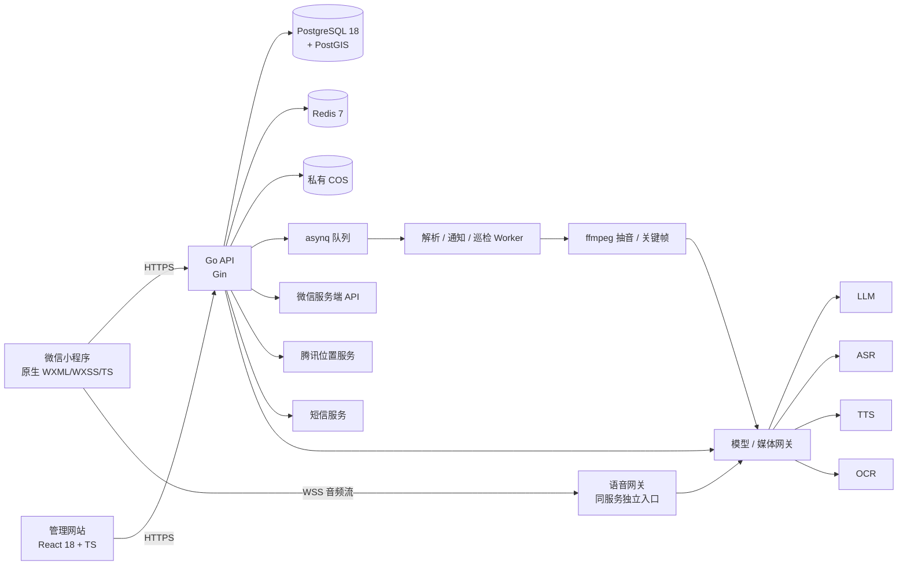

# 房屋中介小程序 · 技术方案（定稿）

> 版本：v1.5（自主获客 3.12 / 3.13 落地）
> 日期：2026-11-22
> 状态：**v1.4 方案已实施；v1.5 新增自主获客模块，批次 1–13 已完成，批次 14 起按 8.2 推进**。
> 范围：微信小程序（房东 / 租客 / 小亿）+ 管理网站（运营 / 审核 / 录入 / 自主获客）+ Go 后端 + PostgreSQL。

### 变更记录

| 版本 | 日期 | 变更 |
|---|---|---|
| v0.1 | 2026-11-20 | 初版评审稿 |
| v0.2 | 2026-11-20 | 按评审意见更新：确认准双工、服务通知、明文联系方式、文档直接上架、微信原生；补充“小区名”上架门槛与“微信账号 → 数据归属”说明 |
| v1.0 | 2026-11-20 | 范围冻结：朋友圈采用 A 小程序发布 + B 截图/文件导入 + C 30 天巡检；自动读取朋友圈暂不处理，移出验收；补充截图 OCR 与小程序发布流程 |
| v1.1 | 2026-11-20 | 增加管理站租房信息录入：文字/图片/视频三种入口；图片 OCR、视频 ASR + 关键帧 OCR、文字结构化提取；按房东手机号/微信号/姓名/公司自动匹配房东，低置信度人工确认 |
| v1.2 | 2026-11-20 | 增加“小亿”动漫 IP 与 AI 找房：欢迎动作/语音、需求多轮收集、最优排序、竖向房源卡、逐套解说、布局/视频/立体地图联动、互动与联系房东 |
| v1.3 | 2026-11-20 | 确认“房屋情况展示”=现有图片逐张展示、边说边换图；不再按“户型面板/单独发给房东”理解；确认立体地图=微信地图 3D/俯视/旋转 + POI/通勤 |
| v1.4 | 2026-11-21 | 融合三项确认：①语音默认准双工，MiniCPM-o Realtime 作为可选引擎（见 3.1.5、5.6）；②PC 微信自动化仅作内部运营工具，不进对外产品与验收（见 3.11）；③自动上架门槛由“小区名”改为“小区名”，词典与字段同步改名（见 3.2.4、4.1） |
| v1.5 | 2026-11-22 | 新增 3.12 潜在租客搜索引导找房、3.13 潜在房东搜索引导发布房源：信息源管理、采集去重、LLM 意向分类与评分、人工复核、人工首条联系、跟进提醒、拒收名单、停机开关、采集调度与退避、站内通知、效果统计、操作审计（见 3.12 / 3.13 / 8.2） |

---

## 0. 一页结论

| # | 需求 | 结论 | 推荐技术路径 | 必须先知道的限制 |
|---|---|---|---|---|
| 1 | 语音双工推荐 | ✅ 已确认“准双工” | 16k PCM 录音 + WebSocket 流式 ASR + LLM 工具调用 + 句级 TTS；播放中可打断 | 真全双工不做；播放时录音能否并存需真机矩阵验证 |
| 2 | Word / Excel 自动入库并上架 | ✅ 可行 | 上传 → 扫描 → 解析 → 小区名识别 → 地理编码 → 直接上架 | 文档必须识别到住宅小区名称；否则转 `pending` 补录 |
| 3 | 登录、手机号、姓氏、角色 | ✅ 可行 | `wx.login` + 手机号快速验证组件 + 姓氏/角色表单 | 手机号能力仅对**非个人、已认证**小程序开放；必须用户主动点按钮 |
| 4 | 租客确认后微信通知房东 | ✅ 已确认服务通知 | 小程序订阅消息（服务通知）+ 站内信留痕 | 需房东主动订阅；一次性订阅发一条消耗一次；不能保证“任意时刻直达” |
| 5 | 本市租房地图、数量、缩放限制 | ✅ 可行 | 微信 `map` + 腾讯位置服务 + PostGIS 空间查询 + 服务端聚合 | 公开位置只到区/街道，不能展示小区门牌；缩放级别需真机校准 |
| 6 | 房源弹窗、联系确认、展示房东联系方式 | ✅ 已确认明文展示 | 底部弹层 + 二次确认 + 联系请求 + 通知 + 明文返回 | 公开详情只展示区/街道；房东发布时需明确授权；限流 + 审计防爬 |
| 7 | 房东朋友圈房源 + 30 天巡检 | ✅ 按 A+B+C 落地 | A 小程序内发布 + B 截图/文件 OCR + C 30 天巡检；自动读取暂不处理 | 微信没有读取个人朋友圈的开放接口；不做爬取/模拟登录 |
| 8 | 小程序 + 管理网站 + 高数据安全 | ✅ 可行 | 模块化单体：Go + PostgreSQL + Redis + 私有 COS；管理站 React | 安全是体系工程，需资质、流程、审计、备份、渗透测试一起做 |
| 9 | 管理站录入文字/图片/视频并自动匹配房东 | ✅ 可行，需人工兜底 | 文字结构化提取 + 图片 OCR + 视频 ASR/关键帧 OCR；手机号/微信号/姓名/公司匹配 `landlord_id` | 视频处理慢、识别有误差；低置信度必须人工确认，不能静默绑定 |
| 10 | 小亿动漫 IP + AI 找房 | ✅ 可行，分阶段 | 原创造型 + Lottie/序列帧；准双工语音；推荐排序；竖向卡片；逐套解说触发“现有图片逐张/视频/立体地图”；确认后联系房东 | 真 Live2D/口型同步、楼栋级 3D 模型不做；首版 Lottie + 句级动作 |
| 11 | 先方案、后代码 | ✅ 本文 | 评审通过后按 M0–M8 小步实施 | 本文不创建代码、不建表、不接第三方 |
| 12 | 潜在租客搜索引导找房（v1.5） | ✅ 已落地（批次 1–13） | 信息源管理 + 采集去重 + LLM 意向分类评分 + 人工复核 + 人工首条联系 + 跟进提醒 + 拒收名单 + 停机开关 + 效果统计 + 操作审计 | 首条联系必须人工；不做自动私信/自动加好友；不抓取非公开内容 |
| 13 | 潜在房东搜索引导发布（v1.5） | ✅ 复用同一线索模型 | `lead_type=landlord`；评分侧重房源描述完整度；复核后人工触达引导小程序发布，终态 `published` | 同 12；不自动发布、不自动绑定房东 |

### 0.1 已确认决策（v1.4 / v1.5）

| 决策 | 结论 | 落地要点 |
|---|---|---|
| 语音 | ✅ 接受“可打断的准双工” | 默认引擎：连续对话、流式 ASR、播放中可打断；真全双工不做；MiniCPM-o Realtime 作为可选引擎，见 3.1.5 |
| 朋友圈 | ✅ 对外采用 A+B+C；内部运营可选 PC 自动化 | A 小程序发布、B 截图/文件 OCR、C 30 天巡检；D 手动分享可选；PC 自动化仅内部工具，不进验收，见 3.11 |
| 通知 | ✅ 用微信“服务通知”发给房东 | 主渠道为小程序订阅消息；需房东主动订阅；站内信留痕 |
| 联系方式 | ✅ 房东联系方式明文展示 | 房东发布时明确授权；租客确认后展示；全程审计、限流 |
| 文档上架 | ✅ 直接上架，但必须有小区名称 | 识别到小区名才自动 `active`；否则 `pending` 补录 |
| 小程序技术栈 | ✅ 微信原生 | 不引 Taro / uni-app |
| 数据归属 | ✅ 关联到该微信账号的数据空间 | 一个 PostgreSQL，多租户按 `landlord_id` 隔离；不是“每个微信一个物理数据库” |
| 管理站录入 | ✅ 文字 / 图片 / 视频 | 文字结构化提取；图片 OCR；视频抽音 ASR + 关键帧 OCR；识别后按房东信息匹配 |
| 房东匹配 | ✅ 自动匹配 + 人工兜底 | 手机号/微信号精确匹配优先；姓名/公司组合降级；低置信度必须人工选 |
| 小亿 IP | ✅ 原创造型 + 分阶段动效 | 首版 Lottie/序列帧 + 6 表情/8 动作；二期评估 Live2D/Spine |
| 小亿交互 | ✅ 准双工 + 推荐流 | 欢迎、需求收集、最优排序、竖向卡片、逐套解说、现有图片逐张/视频/立体地图联动 |
| 语音引擎 | ✅ 准双工默认，MiniCPM-o Realtime 可选 | 默认链路为流式 ASR + LLM + 句级 TTS；MiniCPM 经 `modelgw` 接入，按会话开关，见 3.1.5、5.6；可选引擎不进首版验收 |
| 房屋展示 | ✅ 现有图片逐张播放 | 说到房屋情况时，按解说顺序一张一张展示现有图片，边说边换图；有视频就播视频 |
| 立体地图 | ✅ 微信地图 3D/俯视/旋转 | 周边 POI + 通勤；不支持 3D 的机型降级 2D + 轴测示意图 |
| 联系房东 | ✅ 复用现有确认流程 | 用户说“满意/联系” → 确认框 → 明文联系方式 → 点击拨打 |
| PC 微信自动化 | ✅ 仅内部运营工具 | 不进对外产品与验收；独立 Windows 设备、白名单、限速、人工复核，见 3.11 |
| 自主获客触达方式 | ✅ 100% 人工首条联系 | 服务端只存储人工填写的内容，不自动发送、不自动加好友、不自动私信 |
| 线索联系方式存储 | ✅ 只存 HMAC 哈希 | `contact_hash` 用于跨源去重与拒收名单；原文仅密文存储，查看原文写审计 |
| 拒收与停机 | ✅ 全局生效 | 拒收名单按 `contact_hash` 跨源跨线索生效；`global_halt` 持久化，API 与 worker 跨进程立即生效 |
| 采集频率与重试 | ✅ 每源独立 5–1440 分钟 | 默认 60 分钟；失败按 5/10/20/40/60 分钟退避，且不超过配置间隔 |
| 获客审计 | ✅ 全操作留痕 | 查看原文、复核、联系、跟进、流转、拒收、信息源变更、停机开关均写 `audit_logs` |

### 0.2 需求 7 的处理决议：A+B+C

**结论：按微信现行开放能力，无法实现“自动读取房东朋友圈中的房屋租赁信息”。经评审，v1.0 采用 A+B+C，自动读取暂不处理、移出验收范围。**

原因不是开发工作量，而是平台权限：

1. 微信只提供“分享到朋友圈”，没有提供读取个人朋友圈内容的 API。
2. 小程序登录只返回 `openid` / `unionid`，不提供微信号、朋友圈列表或朋友圈正文。
3. 通过模拟登录、PC 微信 Hook、Android 无障碍服务、爬虫等方式读取朋友圈，违反微信平台规则，可能导致封号；同时可能构成未经授权访问/收集个人信息，法律风险高。
4. 即使买到“能读朋友圈”的灰色服务，也无法保证稳定性、数据真实性和合规性，不能作为生产系统依赖。

**已选择：A+B+C。** 自动读取朋友圈不进入 v1.0 验收；D 作为运营可选，不阻塞开发。

| 方案 | 做法 | 自动化程度 | 合规性 | 范围 |
|---|---|---|---|---|
| A. 小程序内发布 | 房东直接在小程序发布房源，系统自动入库/上架 | 高 | ✅ | **做** |
| B. 截图/文件导入 | 房东把朋友圈截图或 Word/Excel 发给小程序，OCR/解析后入库 | 中 | ✅ | **做** |
| C. 30 天巡检 | 房东发布后，系统每 30 天发“还在租吗”表单 | 中 | ✅ | **做** |
| D. 手动分享 | 系统生成朋友圈文案/海报，房东自己发 | 低 | ✅ | 可选，不阻塞 |

> 如未来平台开放“朋友圈内容读取”能力，再按新接口单独立项；当前不接任何外挂、Hook、爬虫。

**v1.4 内部工具边界：** 业务方确认可用 PC 微信自动化做内部运营（抓取指定房东朋友圈、到期问询），但**不进入对外产品、不进首版验收、不代表平台合规结论**。落地约束见 3.11：专用小号与独立设备、房东白名单与知情同意、限速与人工复核、可一键停机；任何对外宣称仍以 A+B+C 为准。

### 0.3 关于“微信上传直接关联到这个微信关联的数据库存储位置”

这里需要纠正一个实现概念：微信不是数据库，小程序上传的文件也不会“存到微信里”。正确做法是：

```text
微信用户 openid / unionid
  → 后端识别为唯一用户
  → 文件上传到私有 COS
  → 解析任务、房源记录写入同一个 PostgreSQL
  → 每条记录带 landlord_id
  → 所有房东端查询强制 landlord_id = 当前用户
```

也就是“**逻辑上属于这个微信账号的数据空间**”，不是“每个微信一个物理数据库”。原因：

- 2 万用户不可能建 2 万个数据库；迁移、备份、连接池都会失控。
- 管理站需要跨用户审核、统计、风控，物理分库会带来巨大复杂度。
- 安全靠“每条查询强制 `landlord_id` + 对象级校验 + 审计”，不是靠物理隔离。
- 如果未来某个大客户要求独立库，再单独做“专属实例”方案。

---

## 1. 范围、假设与不做的事

### 1.1 MVP 范围

- 单城市起步（可配置切换城市），地图展示该市在租房源。
- 租客：地图找房、小亿 AI 语音找房、推荐房源流、逐套解说、房源详情、确认联系房东、消息中心。
- 房东：微信登录、小程序内发布、上传 Word/Excel、上传朋友圈截图 OCR、房源管理、接收联系提醒、房源到期确认。
- 管理网站：用户/房东/房源/租房信息录入（文字/图片/视频）/小区词典/导入任务/联系记录/通知/巡检/审计/风控。
- 后端：认证、房源、地图聚合、文件/截图导入、联系请求、通知、巡检、审计。
- 自动上架范围：只覆盖能识别出**小区名称**的住宅/公寓房源；商铺、仓库、厂房等其他类型默认 `pending`，人工确认后上架。
- 需求 7 落地：A 小程序发布 + B 截图/文件 OCR + C 30 天巡检；D 手动分享可选；PC 微信自动化仅内部运营（见 3.11）。

### 1.2 首版不做

- 在线签约、在线支付租金/押金、贷款、产权核验。
- 身份证实名认证、人脸识别（可作为二期增强）。
- 站内即时聊天、音视频看房。
- 多城市同时运营、加盟商体系、分佣结算。
- **对外产品自动读取个人微信朋友圈**（平台不开放；只做 A/B/C 替代）；内部运营工具见 3.11，不进产品与验收。
- 对外产品自动加好友、群发、朋友圈爬取/外挂。
- 小亿首版不做实时口型同步、真 3D 城市建模；用句级动作 + 地图 3D/俯视/2D 降级。
- 小亿不自动拨打房东电话；必须用户点击确认并手动点“拨打”。

### 1.3 容量假设

| 指标 | 首年假设 |
|---|---|
| 日活 | 1,000 |
| 峰值并发 | 50 |
| 在租房源 | 10,000 |
| 图片 | 100,000 张，约 30–50 GB |
| 房东/租客用户 | 20,000 |
| 日联系请求 | 200 |
| 日语音对话 | 1,000 轮 |

结论：**不需要微服务**。模块化单体 + 异步 Worker（解析/媒体/通知/巡检）足够，重点是隔离、审计和备份。

---

## 2. 总体架构



### 2.1 技术选型

| 层 | 选型 | 说明 |
|---|---|---|
| 小程序 | **微信原生** WXML/WXSS/TypeScript | 地图、录音、手机号、文件选择都是微信原生能力；不引 Taro，减少构建链和兼容风险 |
| 管理网站 | React 18 + TypeScript + Vite + **HashRouter** | 与现有前端规范一致；TanStack Query 管服务端数据，Zustand 管少量客户端状态 |
| 后端 | Go 1.24+ / Gin | 分层：handler → service → repository；事务只在 service |
| 数据库 | PostgreSQL 18 + PostGIS | 空间索引、事务、行级约束；金额用整数分 |
| 数据访问 | pgx v5 + 手写 SQL | 全部参数化；不引 GORM |
| 缓存/队列 | Redis 7 + asynq | 验证码/会话/限流/地图短缓存；解析、通知、巡检走队列 |
| 媒体处理 | ffmpeg（独立 Worker） | 视频抽音轨/关键帧；沙箱、超时、白名单编码 |
| OCR / ASR | 腾讯云 OCR / ASR | 截图 OCR、视频转写；走统一网关，不直连厂商 SDK |
| 语音引擎 | 默认：ASR + LLM + 句级 TTS；可选：MiniCPM-o 4.5 Realtime | 默认准双工；MiniCPM 经 `modelgw` 代理接入，密钥不出服务端，按会话开关；见 3.1.5、5.6 |
| PC 微信自动化（内部工具） | Python + wxauto（UIAutomation） | 仅内部运营，独立 Windows 设备；不打包进小程序/后台，不进验收；见 3.11 |
| AI 角色 | 2D 动漫 IP + Lottie / 序列帧 | 首版保证启动速度、包体和机型兼容；二期评估 Live2D/Spine |
| 立体地图 | 微信 `map` 的 3D/俯视/旋转 + 2D 降级 | 不支持 3D 的机型降级为 2D 地图 + 轴测图 |
| 对象存储 | 腾讯云 COS 私有桶 | 预签名 URL；原图不公开；图片脱敏、压缩、审核 |
| 接口契约 | OpenAPI 3.1 | 先改 yaml，再改实现；两端生成类型 |
| 部署 | 腾讯云 CVM/容器 + CLB + WAF + 托管 PG/Redis | 与微信生态近，LBS/ASR/TTS/OCR/短信/CMS 一家接通 |

> 说明：现有规范里的 React/Capacitor 约束针对桌面/移动 App 壳；微信小程序是独立宿主，Capacitor 不能打包成小程序。因此小程序用原生，管理站仍用 React；不引入 Taro，避免多一层运行时和兼容风险。

### 2.2 为什么不用微服务/云开发

- 数据少、并发低，微服务只会增加故障面和运维成本。
- 云开发数据库锁定强、复杂空间查询和审计能力弱，不适合“高数据安全”要求。
- 采用**模块化单体**：一个 API 进程 + Worker 进程（解析/媒体可分开部署）；语音网关作为同一代码库的独立 WS 入口，后续可拆。

### 2.3 代码仓库结构（建议）

```text
housing/
├── miniprogram/             微信原生小程序
├── admin-web/               React 管理网站
├── server/
│   ├── cmd/api/
│   ├── cmd/worker/
│   ├── internal/
│   │   ├── auth/            登录、手机号、JWT
│   │   ├── user/            用户、房东/租客资料
│   │   ├── property/        房源、图片、状态
│   │   ├── community/       小区词典、别名、POI
│   │   ├── geo/             地图聚合、地理编码
│   │   ├── importer/        Word/Excel/截图 OCR 解析
│   │   ├── intake/          管理站文字/图片/视频录入、房东匹配
│   │   ├── assistant/       小亿会话、推荐排序、解说脚本
│   │   ├── contact/         联系请求、联系方式解锁
│   │   ├── notify/          订阅消息、站内信、短信
│   │   ├── freshness/       30 天巡检
│   │   ├── admin/           管理站接口
│   │   ├── audit/           审计日志
│   │   ├── modelgw/         LLM/ASR/TTS/MiniCPM 网关
│   │   └── storage/         COS
│   └── migrations/
├── api/openapi.yaml
├── tools/wxagent/           PC 微信自动化（内部工具，独立部署）
├── deploy/
└── docs/
```

### 2.4 工程约束

- handler → service → repository，禁止跨层；事务只在 service 层开；`context.Context` 一路向下传。
- 迁移只新增、不改历史；每次迁移可回滚或至少有前滚预案。
- 先改 `api/openapi.yaml`，再改实现；两端类型生成，不手写重复类型。
- 客户端不存密钥；日志不打印手机号、Token、地址正文、文档内容。
- 小步提交：每个可运行改动单独提交；不一次生成整个模块。

---

## 3. 需求逐项设计

### 3.1 语音找房（需求 1）

#### 3.1.1 交互定义

3.10 的小亿复用本节语音链路，只增加人格、推荐和解说场景。按已确认的“**准双工**”设计，产品上表现为：

- 用户点麦克风后进入连续对话，不用每轮重复点击。
- 系统说话时，用户可以直接开口打断；系统在 300–800 ms 内停止 TTS，转为倾听。
- 一轮结束后自动继续听，直到用户说“结束/退出”或静音超时。

不承诺“像打电话一样同时说和听”。原因：微信小程序没有稳定的原生 AEC（回声消除）能力，`RecorderManager` 与 `InnerAudioContext` 在不同机型上的音频焦点行为不一致；真全双工需要 RTC/原生插件，成本和审核风险都高。

准双工也必须在 iOS/Android 真机矩阵验证“播放时仍能录音”。若系统抢占音频焦点导致录音暂停，则退化为“点一下打断/半双工”，不影响主流程可用。

#### 3.1.2 技术链路

```text
小程序录音 16kHz / 单声道 / PCM
  → WSS 二进制帧（每帧 2–4 KB）
  → 服务端 VAD + 流式 ASR（partial/final）
  → LLM 意图识别 + 工具调用（search_properties）
  → 结构化查询 PostgreSQL/PostGIS
  → LLM 生成口语化回答（只允许引用查询结果）
  → 句级 TTS 音频 URL
  → 小程序顺序播放；用户插话则停止播放并取消当前请求
```

关键参数：

| 项 | 建议值 |
|---|---|
| 采样率 | 16,000 Hz |
| 声道 | 单声道 |
| 格式 | PCM（`RecorderManager` 支持 `format: 'PCM'` 和 `onFrameRecorded`） |
| 帧大小 | 2–4 KB |
| VAD | 服务端能量 + 静音时长；首版 600 ms 静音断句 |
| ASR | 腾讯云实时语音识别，走 `modelgw` 的 speech 路由 |
| TTS | 句级合成，单句 ≤ 60 字；首版不做音频流式 |
| 首包目标 | 用户说完到第一句语音 ≤ 2.5 s（p95） |

#### 3.1.3 意图与槽位

```text
intent: search_property | refine_search | contact_landlord |
        publish_property | freshness_check | chitchat | exit

slots:
  city, district, street, community,
  budgetMin, budgetMax, layout, areaMin, areaMax,
  orientation, floor, tags, commuteTo, pets
```

规则：

- LLM 只做“理解”和“组织语言”，**房源事实必须来自数据库工具结果**。
- 工具返回空结果时，回答“这个条件下暂时没有”，并建议放宽一个条件；禁止编造房源。
- 不在 Prompt 中放手机号、微信昵称、完整地址；只放区/街道和房源公开字段。
- 用户说“联系房东”时，不直接播报联系方式，转入确认流程。

#### 3.1.4 降级策略

| 故障 | 降级 |
|---|---|
| ASR 超时/失败 | 提示“没听清”，保留文字输入；可重试一次 |
| LLM 超时 | 退化为规则解析 + 关键词搜索 |
| TTS 失败 | 只展示文字卡片，不阻断流程 |
| 弱网 | 录音改为 3–8 秒短段上传，非流式 |
| 用户拒绝麦克风 | 全程文字输入，功能不缺失 |

#### 3.1.5 可选引擎：MiniCPM-o 4.5 Realtime

默认链路（流式 ASR + LLM + 句级 TTS）不变；MiniCPM 作为**会话级可选引擎**，用于验证更低延迟的语音直答，不改变默认体验。

- **开关**：创建会话时传 `engine=realtime`（默认 `duplex`）；按灰度白名单启用，失败自动回落默认引擎。
- **接入位置**：只经 `internal/modelgw` 代理；`MAP_API_KEY` 只存服务端环境变量，小程序拿一次性票据，永远接触不到密钥。
- **协议**：`session.queue_done → session.init → input.append*`；下行 `response.output.delta` 按 `kind=listen/text/audio` 分别处理字幕、状态与音频。
- **音频格式**：上行 16kHz 单声道 float32 base64；下行 24kHz float32。小程序播放优先 `wx.createWebAudioContext`，不支持时给 PCM 加 WAV 头写临时文件，用 `InnerAudioContext` 播放。
- **打断**：本地检测上行能量连续 300ms 超阈值即停播并取消当前响应；服务端的 `listen` 事件作为最终兜底。
- **计费与审计**：每次会话写 `usage_records`（音频毫秒、token、trace_id），便于换供应商与核算成本。
- **验收口径**：首版只做技术验证，不纳入对外验收；不影响 A+B+C 与准双工主链路。

### 3.2 文档 / 截图自动入库 + 小程序发布（需求 2）

#### 3.2.0 三条入库入口（对应 A+B）

| 入口 | 适用 | 自动化 | 说明 |
|---|---|---|---|
| A. 小程序表单发布 | 房东手上没有文件，直接填 | 高 | 字段校验 + 小区名联想；命中小区名直接上架 |
| B1. Word/Excel 上传 | 已有房源表/文档 | 高 | 解析表格/段落 + 内嵌图片 |
| B2. 朋友圈截图 OCR | 只有朋友圈截图/复制文案 | 中 | OCR 后走同一套字段映射和小区校验；不是自动读朋友圈 |

#### 3.2.1 支持格式

| 格式 | 首版 | 处理方式 |
|---|---|---|
| `.docx` | ✅ | 标准库 `archive/zip` + `encoding/xml` 解析段落、表格、内嵌图片，避免商业文档库授权风险 |
| `.xlsx` | ✅ | `excelize`（BSD-3）读取单元格、合并单元格、图片 |
| `.doc` | ⚠️ | 提示另存为 `.docx`；或服务端 LibreOffice 沙箱转换（二期） |
| `.xls` | ⚠️ | 提示另存为 `.xlsx`；或服务端转换（二期） |
| `.docm` / `.xlsm` | ❌ | 含宏，直接拒绝 |
| `.jpg` / `.jpeg` / `.png` | ✅ | 仅用于朋友圈截图/文案 OCR；单张 ≤10 MB，最多 9 张 |
| PDF | ❌ | 首版不做；避免 OCR 误差和审核风险 |

> 新增依赖：`excelize`（BSD-3，用于 xlsx 解析）、腾讯云 OCR（截图识别）。`.docx` 用标准库。正式引入前按规范单独确认。

#### 3.2.2 上传与解析流程

```text
入口：
  A. 小程序表单 → 直接进入“字段校验”
  B1. Word/Excel → wx.chooseMessageFile → 上传 API
  B2. 朋友圈截图 → wx.chooseMedia → 上传 API → 腾讯云 OCR
        ↓
  MIME 嗅探 + 扩展名双校验 + 病毒扫描
        ↓
  （B1/B2）入 asynq 解析队列
        ↓
  解析正文/表格/图片 或 OCR 文本
        ↓
  字段映射（规则优先，LLM 兜底）
        ↓
  **小区名识别**（小区词典 + 腾讯 LBS POI）
        ↓
  地址地理编码（区/街道/小区）
        ↓
  校验（面积、租金、小区名、区/街道）
        ↓
  命中小区名：直接 properties.status=active（上架）
  未命中：properties.status=pending，原因 missing_community_name
        ↓
  生成错误行报告 / 待补录清单
```

#### 3.2.3 字段映射

| 标准字段 | 常见表头同义词 |
|---|---|
| 小区名称（必填） | 小区、花园、苑、广场、公寓、大厦、中心、地址 |
| 房源类型 | 类型、物业类型、住宅、公寓、合租、整租、小区 |
| 区 | 区、区域、行政区、城区 |
| 街道 | 街道、片区、商圈、板块 |
| 面积 | 面积、建筑面积、㎡、平米 |
| 租金 | 租金、价格、月租、元/月 |
| 户型 | 户型、房型、几室几厅 |
| 朝向 | 朝向、方向 |
| 楼层 | 楼层、所在层、总层 |
| 图片 | 图片、照片、实拍 |

规则：

- 表头同义词表 + 列类型推断；无法确定时调用 LLM 做“列名 → 标准字段”映射，返回 JSON Schema 约束。
- 多行 Excel：每行一套房源；合并单元格向下填充。
- Word：优先解析表格；没有表格时按“字段名：值”段落解析；支持一个文档多套房源。
- 截图 OCR：按文本块/行合并，识别小区名、面积、租金、区/街道；一张截图多套房源时逐条拆分，拆不准则 `pending`。
- 截图中的微信昵称/头像/手机号/门牌先脱敏；原图 7 天删除，公开页不复用原图。
- 房东上传截图时必须勾选“这是我本人的房源，或已获得发布授权”；否则拒绝。
- 图片：Excel 内嵌图片按锚点行匹配；Word 图片按出现顺序匹配；匹配不上则进入待补图。
- 地址用于地理编码和内部匹配；**公开展示只到“区/街道”**，小区名和门牌不对外；完整地址写入加密字段，仅房东和管理员（审计后）可见。
- 原文标题/描述单独加密保存；公开标题由系统生成；发布前用规则 + 正则 + NER 去除小区名、门牌、手机号、微信号。

#### 3.2.4 校验与入库策略

| 校验 | 处理 |
|---|---|
| **小区名称** | 必须命中小区词典或 LBS POI；未命中直接 `pending`，不得上架 |
| 房源类型 | 必须是住宅/公寓；商铺、仓库、厂房等转 `pending` |
| 面积 5–1000 ㎡ | 缺失或超出范围转 `pending`，不直接上架 |
| 月租 100–1,000,000 元 | 缺失或超出范围转 `pending`，不直接上架 |
| 区/街道必须属于当前城市 | 不通过则转 `pending`，要求人工选择 |
| 小区无法地理编码 | 降级到街道中心点，标记 `precision=street`；仍可上架但只展示区/街道 |
| 重复房源 | 房东 + 小区 + 面积 + 租金 + 户型 模糊去重；重复则更新原记录，不重复上架 |
| 图片缺失 | 允许上架，标记“待补图”；前端使用占位图，不展示空轮播 |

**“直接上架”的硬门槛（全部满足）：**

1. 文档/表格/截图中识别出**小区名称**；
2. 该名称能匹配到小区词典或 LBS POI（精确/别名/高置信模糊）；
3. 能解析出面积、月租、区/街道；
4. 不是重复房源（重复则合并更新）。

任一不满足 → `properties.status=pending`，并在导入结果页列出原因；房东补录后一键上架。这样既满足“直接上架”，也不会把缺小区名的脏数据放到地图上。

**小区词典：**

- 新增 `communities` 表：标准名称、别名、类型（住宅/公寓）、城市/区/街道、POI ID、中心点、状态。
- 首次上线前，用腾讯 LBS POI + 人工整理，导入目标城市的住宅小区清单。
- 文档/截图解析优先匹配词典；词典没有时调 LBS POI 搜索；仍无结果则 `pending`。
- LBS POI 命中但词典无记录时，自动创建 `communities` 记录（`source=lbs`、`review_status=pending`），保证 `community_id` 有值；管理站抽检。
- 管理站可维护小区别名，解决“XX花园”与“XX花苑”不一致的问题。

**自动上架后的风控：**

- 每条自动上架记录保留 `import_job_id`、源文件哈希、解析置信度、小区匹配方式。
- 管理站可一键下架并追溯到具体文档/行号。
- 同一房东 24 小时内自动上架超过 50 条时，转人工抽检。
- 图片缺失、描述为空、租金异常低的记录，进入“自动上架但待复核”队列。

#### 3.2.5 文件安全

- 只接受白名单 MIME；扩展名与文件头不一致直接拒绝。
- 限制 20 MB、单文件 500 行、100 张图；解析超时 60 s、内存上限 512 MB。
- 防 ZIP 炸弹、XML 实体膨胀；不执行宏、不执行公式、不调用外部链接。
- 原文件/截图加密存储，**7 天后自动删除**；只保留解析后的结构化数据和必要的错误报告。
- 截图 OCR 前先去 EXIF、压缩；识别到二维码/小程序码默认打码，防止引流和恶意跳转。
- 错误报告导出 Excel 时防公式注入（以 `'` 前缀处理 `= + - @`）。

#### 3.2.6 小程序内发布（A 路径）

- 页面：`pages/landlord/publish`，房东角色才可见。
- 必填：小区名（联想选择，不允许自由文本直接提交）、房源类型、面积、月租、区/街道、联系方式授权。
- 选填：楼层、朝向、户型、描述、图片。
- 小区名输入时调 `GET /v1/communities/suggest`，必须从候选里选；选不到则提示“补充小区名/联系运营”，不能直接发布。
- 提交后服务端重新校验小区和字段；命中住宅小区且核心字段齐全 → `active`；否则 `pending` 并返回缺什么。
- 图片先上传到私有 COS，压缩、去 EXIF、内容审核；未通过不展示。
- 发布成功后立即引导“开启接单通知”（`wx.requestSubscribeMessage`）。
- 草稿自动保存到本地 + 服务端，防止误退出丢失。
- 这是当前版本的主入口；文档/截图导入是批量补充。

### 3.3 登录、手机号、姓氏、角色（需求 3）

#### 3.3.1 触发时机

- 浏览地图、看房源详情：**不强制登录**。
- 点“联系房东”、发布房源、查看消息、房东管理：强制登录。
- 未登录时弹出登录页/半屏弹层；登录成功后回到原来的动作，不丢上下文。

#### 3.3.2 流程

```text
1. 小程序启动静默 wx.login → code
2. 后端 code2Session → openid / unionid，签发短 token
3. 用户点“联系房东” → 检查 /me：
   - 无 token / 过期 → 登录页
   - 有 token 但未填手机号/姓氏/角色 → 资料页
4. 资料页：
   - 手机号：<button open-type="getPhoneNumber">，用户主动点击
   - 后端用 code 调微信 getPhoneNumber，立即加密存储
   - 姓氏：1–10 个字符，允许复姓
   - 角色：房东 / 租赁方（租客），二选一
   - 勾选《隐私政策》和《用户协议》
5. 提交 → 后端校验 → 完成资料 → 回到原动作
```

要点：

- 手机号能力仅对**非个人、已认证**小程序开放；上线前必须确认主体资质。
- 接入微信隐私保护指引：首次调用手机号、位置、录音前，用 `wx.requirePrivacyAuthorize` 或隐私弹窗取得同意；隐私政策列明第三方 SDK。
- 不调用 `wx.getUserProfile` 强拉头像昵称；头像用 `chooseAvatar`，昵称让用户自己填，且都可跳过。
- 手机号用 AES-256-GCM 加密存储；另存 HMAC-SHA256 哈希用于唯一性校验和查询；列表只展示 `138****1234`。
- 角色首版不允许用户随意切换；切换需走管理站审核，避免房东/租客身份混乱。
- 微信 `access_token` 由后端统一缓存/刷新，禁止下发客户端；与小程序用户 token 分开管理。
- Token：access 15 分钟、refresh 30 天，刷新时轮换；refresh 只存服务端哈希；敏感操作要求重新 `wx.login` 校验。
- 账号注销：15 天冷静期；删除/匿名化个人资料，保留必要的交易/审计记录。
- 待认领房东：管理站代录时若手机号命中 `status=unclaimed` 记录，房东登录后提示“认领名下房源”，需短信/手机号验证后合并；不能仅凭手机号静默合并。

### 3.4 通知房东（需求 4）

#### 3.4.1 先纠正一个事实

微信小程序**拿不到用户的微信号**。登录只返回 `openid` / `unionid`；昵称和头像也需要用户主动授权。因此“提示是哪个微信”只能做到：

- 姓氏；
- 用户授权后的微信昵称/头像；
- 脱敏手机号；
- 房源标题、时间。

如果业务坚持“必须显示微信号”，只能让用户**手动填写微信号**，且不能保证真实。

另外，小程序不能直接向房东发送“微信联系人名片”；只能通过订阅消息/站内信发送固定模板字段，或让房东在小程序内查看联系记录。

#### 3.4.2 通知渠道

| 渠道 | 能力 | 限制 | 首版 |
|---|---|---|---|
| 小程序订阅消息 | **微信“服务通知”里直达**，可跳小程序 | 需房东事先主动订阅；一次性订阅发一条消耗一次；长期订阅仅限政务/医疗/交通/金融/教育等类目 | ✅ **唯一推送主渠道** |
| 站内信 | 一定可达，登录可见 | 无微信推送 | ✅ 必做（留痕） |
| 公众号模板消息 | 也在服务通知里，可多次触达 | 需认证服务号、房东关注、unionid 绑定 | ⚠️ 二期可选 |
| 短信 | 可达 | 有成本；内容需合规；易被拦截 | ⚪ 默认关闭，仅运营手动开启 |

> 房地产/房屋中介不属于长期订阅消息的开放类目，不能假设“订阅一次、永久推送”。房东每次发布/确认房源时，必须引导其点击“开启接单通知”（`wx.requestSubscribeMessage`）；未订阅时只能走站内信，不能伪造“已发微信”。

订阅 UX：

- 房东发布成功后，立即弹“开启接单通知”；拒绝不阻断发布。
- 房东打开“我的房源/消息设置”时，提供“再次开启”按钮，补充订阅次数。
- 每次收到联系请求后，若订阅额度已用完，站内信提示“下一次联系前请重新开启通知”。
- 不在启动时静默请求，避免骚扰和审核问题。

#### 3.4.3 联系流程

```text
租客点“联系房东”
  → 登录/资料校验
  → 弹出确认框：
     标题：确定需要联系房东吗？
     按钮：放弃 / 确认
  → 确认：
      POST /v1/contact-requests（幂等键）
      服务端校验房源在租、租客手机号、频率限制
      写 contact_requests + notification_outbox
      异步发送：微信服务通知（订阅消息）→ 站内信留痕（短信默认关闭）
      返回房东联系方式（明文，按房东发布时的授权）
  → 展示房东微信/电话，提供“拨打/复制”
  → 全程写 audit_logs
```

通知内容建议（按订阅消息模板字段裁剪，不发送长文本）：

```text
房源：{区/街道} · {面积}㎡ · {租金}元/月
租客：{姓氏}先生/女士
电话：{138****1234}
时间：{MM-dd HH:mm}
备注：点击查看详情并联系租客
```

安全与体验：

- 同一租客对同一房源 7 天内只允许发起 1 次；每天最多 3 次、每月最多 10 次。
- 房东发布房源时必须**明确勾选**“同意向确认联系的租客展示真实手机号/微信号”；不勾选则房源可发布，但联系按钮显示“房东未授权联系方式”。
- 明文展示范围：房东登录手机号 + 房东手动填写的微信号；**微信号无法从微信自动获取**，没填就只显示手机号。
- 联系方式只在租客确认后、通过 `POST /v1/contact-requests` 一次性返回；地图/列表/详情接口绝不返回。
- 页面加水印、复制提示、审计和频率限制；截屏无法完全防止，这是明文展示的已知风险。
- 通知即房东侧“备注”：记录租客姓氏、脱敏手机号、房源、时间；房东可在联系记录中查看。
- 通知失败不影响租客已提交的请求，但页面要如实提示“已记录，房东可能稍后查看”，不能显示“微信已发送”。
- 房东端的“哪个微信”只写昵称/头像（若有）和姓氏，不写 openid。
- **不在租客登录后立即群发所有房东**；只对租客本次确认联系的房源房东发送，避免骚扰和隐私泄露。

### 3.5 地图首页（需求 5）

#### 3.5.1 页面结构

- 全屏 `map` 组件。
- 顶部：当前城市、搜索框、语音按钮。
- 底部：可拖拽的房源卡片列表；与地图 marker 联动。
- 右下：定位、缩放、列表/地图切换。

#### 3.5.2 缩放与范围

| 需求 | 实现 |
|---|---|
| 最小中国地图 | `min-scale=3` |
| 最大街道级 | `max-scale=16`；关闭 3D、俯视、楼块、室内图 |
| 只展示本市 | 以定位城市为 `cityCode`，服务端强制过滤 |
| 缩小到全国 | 允许看全国轮廓，但只展示“有房源城市”的聚合数；点城市切换当前城市 |
| 移动地图 | `bindregionchange` 的 `end` 事件取西南/东北角，300 ms 防抖后查询 |
| 数量展示 | 低 zoom 按区/街道聚合；高 zoom 按街道网格聚合，marker 上带数量 |

缩放级别建议：

| zoom | 展示 |
|---|---|
| 3–8 | 全国/省，城市级聚合数，不展示具体房源 |
| 9–11 | 城市/区，区级聚合数 |
| 12–14 | 街道/商圈，街道聚合数 |
| 15–16 | 街道网格，单房源 marker 或网格聚合 marker；不展示小区名 |

#### 3.5.3 空间查询

- `properties.geom` 使用 `geometry(Point, 4326)`，GiST 索引；坐标统一用 GCJ-02（与微信地图一致），只做包围盒/范围查询，不用它算真实米制距离。
- 查询：`geom && ST_MakeEnvelope(swLng, swLat, neLng, neLat, 4326)` + 状态/城市过滤。
- 聚合：低 zoom 按 `district_code` / `street_code`；高 zoom 按 `geohash6` / 街道网格；小区 ID 只用于内部去重，不对外返回；最多 300 个点。
- 缓存：Redis 缓存 `map:{city}:{zoom}:{bbox 取整}` 30 秒；房源发布/下架时按城市失效。
- 限流：单用户 10 次/10 秒；异常高频进风控。
- 腾讯位置服务：Key 绑定小程序 AppID/域名白名单；配置日配额告警；确认商用授权和地图数据合规要求。

#### 3.5.4 隐私

- 公开接口只返回：区、街道、聚合坐标、数量、面积、租金、户型、图片。
- 不返回小区名、门牌号、房东姓名、电话、微信号。
- 公开标题/描述由系统生成（区/街道 + 房源类型 + 面积/租金）；原文中的小区名、门牌、电话、微信号做二次脱敏，不能靠“前端不展示”掩盖。
- 图片审核抽检门牌、公司招牌；必要时打码，避免图片反向定位。
- marker 坐标使用街道中心点 + 确定性偏移（±100–300 m），同一房源每次偏移一致，避免“多点定位”反推真实门牌。
- 房东自己的管理页才显示完整地址；管理员查看完整地址需填理由并写审计。

#### 3.5.5 定位与降级

- 首屏用 `wx.getFuzzyLocation` 只取城市，降低隐私敏感度；用户点“附近”再申请精确位置。
- 拒绝定位：按 IP 粗略城市 + 手动城市选择，不阻断浏览。
- 地图加载失败：降级为列表页，仍可按区/街道/租金筛选。
- `app.json` 配置 `requiredPrivateInfos`、`permission.scope.userLocation`，并写明用途。

### 3.6 房源详情与联系房东（需求 6）

#### 3.6.1 弹层内容

- 图片轮播（压缩图 + 原图按需加载）；上传先压缩、去 EXIF、过内容安全审核，未通过不上架。
- 区/街道（不展示小区名和门牌）。
- 面积、租金、户型、朝向、楼层、标签。
- 在租状态、最近确认时间。
- 房源描述（敏感信息过滤）。
- “联系房东”按钮。

#### 3.6.2 确认框

必须逐字使用：

```text
确定需要联系房东吗？
[放弃]  [确认]
```

点击“确认”后：

1. 服务端创建 `contact_request`（幂等）。
2. 校验租客已登录、手机号已验证、房源 `active`。
3. 发送微信服务通知（订阅消息）+ 站内信留痕。
4. 返回房东联系方式**明文**（手机号 + 房东填写的微信号）；页面展示并提供拨打/复制。
5. 写审计：谁、何时、对哪套房、查看了什么。

#### 3.6.3 房东联系方式（已确认明文展示）

- 房东在发布房源时填写/确认：手机号（默认取登录手机号）、微信号（手动填，可选）；必须勾选“同意向确认联系的租客展示”。
- 房东可随时关闭展示；关闭后租客只看到“已通知房东”，不会再返回明文。
- 首版**不做默认虚拟号**；按评审决定直接展示房东授权的真实号码。
- 页面明示“仅用于本次租房联系”，加水印、复制提示；后台保留查看审计。
- 明文展示的已知风险：租客可截图/转发，无法技术阻止；用“手机号已验证 + 频率限制 + 异常风控 + 封禁”降低批量抓取。

### 3.7 朋友圈与 30 天在租巡检（需求 7）

#### 3.7.1 结论：原样不可行

微信官方只提供“分享到朋友圈”（`onShareTimeline`），**没有提供读取个人朋友圈内容的接口**。任何“自动获取房东朋友圈”的方案，本质上都要模拟登录、爬取或逆向，违反微信平台规则，可能导致封号，并涉及个人信息侵权。

自动读取已移出 v1.0，属于“暂不处理”的需求，不进入验收。如果未来必须做，前提是微信开放相应接口或更换平台；当前不会用外挂/爬虫硬做。

#### 3.7.2 替代方案：小程序发布 / 截图 OCR / 到期巡检 / 手动分享

**A. 小程序内发布（已确认，首选）**

- 房东直接在小程序发布房源，字段校验/小区匹配与文档导入共用同一套逻辑。
- 发布即入库；命中住宅小区名且核心字段齐全时直接 `active`。
- 这是“自动入库”的主路径，不依赖朋友圈。

**B. 截图/文件导入（已确认，半自动合规）**

- 房东把朋友圈截图、复制的文案、Word/Excel 发给小程序。
- 系统 OCR + 字段解析 + 小区名识别；命中住宅小区名后直接上架。
- 这不是“自动读取朋友圈”，每次仍需房东主动操作；但合规、稳定，且与现有文档导入链路复用。

**C. 30 天巡检（已确认，满足“是否还在租”的核心目的）**

```text
每日 10:00 定时任务
  → 找 active 且 last_confirmed_at < now()-30d 的房源
  → 发微信服务通知（订阅消息）/站内信：
     “你的房源 {小区名} 已发布 30 天，还在租吗？”
  → 跳到小程序确认页：
     [还在租] [已租出] [已下架]
  → 更新 properties.status / last_confirmed_at
  → 3 天未回应：再提醒一次
  → 7 天未回应：自动 status=stale，地图隐藏
  → 管理员可复核、恢复
```

**D. 手动分享（可选，不阻塞）**

- 房源详情页支持“生成朋友圈文案/海报”，房东一键保存图片，手动发朋友圈。
- 支持 `onShareTimeline` 分享房源页到朋友圈（用户主动）。
- 分享行为只能统计“分享按钮点击”，无法知道是否真的发到朋友圈，也无法读取内容。

**E. 公众号/视频号**

- 如果运营方有认证公众号/视频号，可走官方内容接口做内容同步；但这不等于“房东个人朋友圈”。

### 3.8 管理网站（需求 8）

#### 3.8.1 页面

| 页面 | 功能 |
|---|---|
| 登录 | 账号密码 + TOTP 二次验证 |
| 仪表盘 | 房源数、在租数、待确认、联系请求、异常 |
| 用户 | 租客/房东列表、状态、注销申请 |
| 房东 | 资料、房源、联系方式授权、风控标记 |
| 房源 | 审核、上下架、修改、图片审核、状态历史 |
| 租房信息录入 | 文字/图片/视频录入、识别结果预览、房东匹配、发布 |
| 小区词典 | 小区名称、别名、POI、类型、审核 |
| 导入任务 | 文件、解析进度、错误行、重试 |
| 联系记录 | 请求、通知结果、投诉、异常频率 |
| 巡检 | 待确认、stale、恢复 |
| 审计 | 管理员操作、敏感数据查看 |
| 配置 | 城市、模板、通知开关、限流阈值 |

#### 3.8.2 管理站安全

- 独立域名、独立 JWT audience，不与小程序 token 混用。
- 密码 argon2id；强制 TOTP；登录失败锁定；会话 8 小时、闲置 30 分钟。
- RBAC：超级管理员 / 运营 / 审核 / 客服 / 审计只读；最小权限。
- 管理站 token 不放 localStorage：refresh 用 `HttpOnly + Secure + SameSite=Strict` Cookie，access 只放内存；配 CSRF token。
- PII 默认脱敏；查看完整手机号/地址需填理由，写审计；不提供批量导出接口。
- 管理站录入页的手机号默认脱敏显示，匹配由服务端哈希完成；需要人工核对时单独点“显示”，写审计。
- 管理站 IP 白名单（可选）、WAF、CSP、HSTS、X-Frame-Options。

### 3.9 管理站租房信息录入（文字 / 图片 / 视频）

#### 3.9.1 定位

管理站录入是**房东自主发布的补充渠道**，用于运营代录、房东不会用小程序、或只有朋友圈截图/视频的情况。视频只用于识别房源信息，**不作为对外播放的看房视频**。它不改变两条底线：

- 公开信息仍然只到区/街道，不展示小区名、门牌、房东联系方式。
- 房东归属必须可追溯；低置信度不能静默绑定。

#### 3.9.2 页面流程

页面：`/admin/rentals/new`

```text
选择输入方式
  ├─ 文字：粘贴朋友圈文案/房源介绍
  ├─ 图片：上传 1–9 张截图/照片
  └─ 视频：上传 ≤200 MB、≤5 分钟的看房视频
        ↓
异步识别（文字结构化 / 图片 OCR / 视频 ASR + 关键帧 OCR）
        ↓
左侧：原始内容预览（文字高亮 / 图片 / 视频时间轴）
右侧：识别出的房源字段 + 每个字段置信度
        ↓
小区名匹配（小区词典 + LBS POI）
        ↓
房东匹配（手机号/微信号/姓名/公司/小区）
        ↓
重复房源检查
        ↓
管理员确认/修正 → 发布（active）或转 pending
```

页面要求：

- 文字、图片、视频三种入口在同一个页面切换，识别结果落到同一个 `ListingDraft`。
- 识别结果必须可编辑；每个字段显示来源（原文第几段/第几张图/视频第几秒）。
- 视频识别结果带时间戳，点击时间戳可跳转到对应画面。
- 房东匹配面板显示候选房东、匹配依据、置信度、名下房源数；默认不选任何低置信度候选。
- 发布前展示“公开后用户会看到什么”，确认没有小区名/门牌/电话泄露。
- 默认沿用“小区名 + 核心字段”上架门槛；管理员强制发布需要 `publish_override` 权限、填写理由并写审计。
- 原始媒体只对内预览；不能一键下载/打包导出。

#### 3.9.3 识别链路

```text
文字
  → 清洗（去表情/重复行/免责声明）
  → 规则抽取 + LLM 结构化抽取
  → ListingDraft

图片
  → 压缩/去 EXIF
  → OCR（腾讯云）
  → 版面合并（标题/正文/表格/聊天记录）
  → 规则 + LLM 结构化
  → ListingDraft

视频
  → ffmpeg 抽音轨（16k mono）
  → ASR（带时间戳）
  → 关键帧抽取（每 2–5 秒或镜头切换）
  → 关键帧 OCR
  → 转写文本 + OCR 文本合并去重
  → 规则 + LLM 结构化
  → ListingDraft
```

说明：

- “文字转文字”不是多此一举：原文往往混着表情、重复标点、联系方式、非房源内容，需要清洗并结构化成字段。
- 视频不把整段视频送模型，只送**转写文本 + 关键帧 OCR 文本**，控制成本、延迟和隐私。
- 视频里的房东自述（“我是 XX 园区王先生，电话 138…”）走 ASR + 手机号正则/NER 提取，作为房东匹配依据。
- OCR/ASR 低置信度的字段留空，不猜；由管理员补。
- 识别失败可重试；原始媒体保留 7 天，转写文本保留 30 天。

#### 3.9.4 房东自动匹配

识别出的房东身份字段：

| 字段 | 来源 | 用途 |
|---|---|---|
| 手机号 | 文字/图片 OCR/视频 ASR | 最强匹配键；服务端只存哈希用于匹配 |
| 微信号 | 文字/图片 OCR | 次强匹配键；房东手动填过才能匹配 |
| 姓氏/姓名 | 文字/OCR/ASR | 辅助匹配；不能单独作为依据 |
| 公司/小区 | 文字/OCR/ASR | 辅助匹配；与姓名组合 |
| 房东编号 | 管理站已有数据 | 精确匹配 |
| 小区/面积/租金 | 房源字段 | 查重、辅助确认 |

匹配顺序与阈值：

| 优先级 | 规则 | 置信度 | 处理 |
|---|---|---|---|
| 1 | 手机号哈希精确命中 | 1.00 | 自动关联 |
| 2 | 房东编号精确命中 | 1.00 | 自动关联 |
| 3 | 微信号哈希精确命中 | 0.98 | 自动关联 |
| 4 | 手机号后四位 + 姓氏 + 小区/公司 | 0.70–0.90 | 候选，管理员确认 |
| 5 | 姓氏 + 公司/小区 + 近期房源 | 0.60–0.80 | 候选，管理员确认 |
| 6 | 公司/姓名模糊匹配 | 0.50–0.70 | 候选，管理员确认 |
| 7 | 无匹配 | — | 建“待认领房东”或留空 |

规则：

- 手机号统一规范为 E.164（默认 +86）；微信号转小写去空格；公司名走别名表。
- **禁止只凭姓氏自动绑定**；“王先生”重名率太高。
- 只有唯一候选且置信度 ≥0.90 才自动关联；0.60–0.90 必须人工点选；<0.60 不自动关联。
- 自动关联也要写审计：匹配依据、置信度、原始片段。
- 匹配到房东后，再按“房东 + 小区 + 面积 + 租金 + 户型”查重；重复则更新原房源，不新建。
- 找不到房东时：
  - 有手机号：创建 `users.status=unclaimed` 的待认领房东（`openid` 允许为空），房源挂在该记录下；
  - 房东之后用同一手机号登录，自动认领并合并；
  - 没有手机号：房源可先 `pending`，管理站补录房东后再发布。
- 管理员手动改绑房东必须填理由，写审计；不能批量改绑。
- `match_status`：`auto_matched` / `candidates` / `unmatched` / `manual_matched`；管理站列表按此筛选。

#### 3.9.5 数据模型增补

| 表 | 关键字段 | 说明 |
|---|---|---|
| `rental_intake_jobs` | id, uuid, admin_id, input_type, raw_text_enc, media_keys, transcript_enc, ocr_text_enc, extracted_json, landlord_id, match_confidence, match_status, property_id, status, error_code, created_at | 管理站录入任务 |
| `media_assets` | id, intake_id, kind, object_key, duration_ms, width, height, keyframe_ms, transcript_enc, ocr_text_enc, moderation_status | 图片/视频/关键帧资产 |
| `landlord_aliases` | id, landlord_id, alias_type, alias_hash, alias_enc, verified | 姓名/公司/微信号别名，辅助匹配 |
| `landlord_claims` | id, phone_hash, landlord_id, status, claimed_at | 待认领房东与登录认领 |

`properties.source_type` 增加：`admin_text` / `admin_image` / `admin_video`。
`users.openid` 允许为空（待认领房东），并加部分唯一索引：`WHERE openid IS NOT NULL`；`users.status` 增加 `unclaimed`。

#### 3.9.6 接口

| 方法 | 路径 | 说明 |
|---|---|---|
| POST | `/v1/admin/rentals/intake/text` | 提交文字，创建识别任务 |
| POST | `/v1/admin/rentals/intake/media` | 上传图片/视频，创建识别任务 |
| GET | `/v1/admin/rentals/intake` | 录入任务列表 |
| GET | `/v1/admin/rentals/intake/{uuid}` | 识别进度、字段、房东候选 |
| POST | `/v1/admin/rentals/intake/{uuid}/match` | 手动选择/改绑房东 |
| POST | `/v1/admin/rentals/intake/{uuid}/publish` | 确认发布/转 pending |
| GET | `/v1/admin/landlords/match` | 按手机号/微信号/姓名/公司查候选 |

#### 3.9.7 媒体与识别安全

- 原始图片/视频进私有 COS，短时签名预览；7 天后删除；转写文本 30 天。
- 视频只接受 MP4/MOV 等白名单编码；ffmpeg 跑在独立 Worker/沙箱，超时 5 分钟、内存 1 GB，禁止外链输入。
- 防视频炸弹、图片解压炸弹、超大分辨率；先探测时长/分辨率再处理。
- 手机号/微信号先由服务端正则/NER 提取并哈希，再对文本脱敏；LLM 只收脱敏文本，不接触原始联系方式。
- 视频内容审核（涉黄/暴恐/引流二维码）；未通过不进识别结果页。
- 上传者需确认已获得视频中人物/房东的肖像、声音使用授权；涉及第三方人脸时打码或拒绝。
- 管理站查看原始媒体、修改房东绑定都写审计；不提供批量导出。

#### 3.9.8 验收

- 文字录入：字段抽取准确率 ≥95%，5 秒内出结果。
- 图片录入：9 张以内 15 秒内出结果，字段准确率 ≥90%。
- 视频录入：5 分钟视频 2 分钟内出转写/关键帧结果；清晰语音字段准确率 ≥85%。
- 房东匹配：手机号/房东编号精确命中 100% 自动关联；低置信度 0 例静默绑定。
- 安全：原始媒体 7 天删除；日志无明文手机号；管理员改绑有审计。

### 3.10 小亿 AI 机器人（动漫 IP + 找房）

#### 3.10.1 定位

小亿是租客端的**虚拟找房助手**，不是独立 App，也不是客服机器人。它叠加在现有地图/房源/语音链路上：

- 人格：亲和、专业、不夸张；称呼用户“你”，不自称真人。
- 职责：欢迎 → 问需求 → 复述确认 → 推荐 → 逐套解说 → 处理“下一套/周边/视频/联系房东”。
- 边界：不编造房源、不承诺租金、不自动拨打房东电话、不在确认前泄露房东联系方式。
- 标注：页面固定显示“AI 虚拟助手”，避免用户误认为是真人。

#### 3.10.2 动漫 IP 与资产

首版做**原创 2D 动漫形象**，不直接使用任何现有动漫角色，避免版权风险。

| 项 | 首版交付 |
|---|---|
| 造型 | 正面/侧面/背面三视图；职业装；主色与品牌一致；胸前“亿”字徽章 |
| 表情 | 中性、微笑、思考、惊讶、指向、开心 6 套 |
| 动作 | 挥手、鞠躬、指向、摊手、点头、托腮、点赞、引导 8 套 |
| 格式 | Lottie（循环/微动效）+ WebP 序列帧（欢迎/转身）+ 静态兜底图 |
| 体积 | 首屏角色资源 ≤1 MB；其余放 CDN/分包，不塞主包 |
| 声音 | 品牌定制音色；欢迎语可预录，解说是 TTS；配音/克隆需授权 |
| 版权 | 原画/建模/动作/配音合同约定著作权归项目方；商标检索（第 9/35/36/42 类）；不做他人 IP 二创 |

技术选择：

- **首版 Lottie + 序列帧**：稳定、包体小、机型兼容好；不做实时口型同步。
- **二期 Live2D/Spine**：需要 WebGL/Canvas 适配、性能测试和更高美术成本，单独立项。
- 动作与语音按**句级**同步：一句话开始触发一个动作；不做音素级口型。
- 新增 `lottie-miniprogram`（MIT）需评审确认；若不引依赖，用 WebP 序列帧 + 静态图，动作数量相应减少。

#### 3.10.3 打开欢迎

```text
用户打开小程序
  → 地图首屏
  → 小亿从右下角跳出（缩放 + 弹跳 + 挥手）
  → 气泡：“我是小亿，想找什么样的房子？”
  → 欢迎语音（首次/每日首次）
  → 用户点击/说话 → 进入需求收集
```

细节：

- 动画可以自动播；**声音受微信自动播放限制**，首次通常需要用户点一下“听小亿说”。未点则只显示字幕气泡，不静默失败。
- 欢迎语 2–3 个版本轮换，避免每次一模一样；同一用户每天最多自动弹一次，可关闭“下次不再自动跳出”。
- 不遮挡地图操作；可上滑收起/点“跳过”。
- 欢迎语音与动作由 `welcome` 脚本驱动，预生成音频，首包 ≤300 KB。

#### 3.10.4 需求收集

槽位：

```text
city, district, street, community_type,
budgetMin, budgetMax, areaMin, areaMax,
layout, floor, orientation, commuteTo,
moveInDate, needVideo, tags
```

规则：

- 每轮最多问 2 个问题，不一次性盘问。
- 用户说“没有了/就这些/开始找” → 复述需求 → 确认 → 搜索。
- 用户不确定时给默认值并说明：“先按 3000–5000 元、50–80㎡ 找，不合适再放宽”。
- 复述必须包含：区域、预算、面积/户型、小区类型、特殊要求。
- 需求存 `assistant_sessions.slots`，退出后可恢复；用户可清空。
- 语音走 3.1 的准双工链路；文字输入同样可用。

#### 3.10.5 推荐与“最优”排序

先做硬过滤，再打分排序：

| 维度 | 权重 | 说明 |
|---|---|---|
| 预算匹配 | 30 | 在预算内满分；超出 10% 内递减 |
| 区域/通勤 | 20 | 区/街道命中；有通勤目的地时按地图估算 |
| 面积/户型 | 20 | 满足区间/户型 |
| 小区类型 | 10 | 住宅/公寓匹配 |
| 新鲜度 | 10 | 30 天内确认过优先 |
| 资料完整度 | 5 | 图片/视频/描述完整 |
| 房东响应 | 5 | 历史联系响应率（不含个人敏感信息） |

规则：

- 返回最多 20 套；同小区最多 2 套、同房东最多 3 套，避免刷屏。
- 每套显示“匹配度 92%”和 2–3 条理由，不写“全网最优/绝对最低价”。
- 没有完全匹配时，展示“最接近的 3 套”，明确差在哪一项，并允许一键放宽预算/面积/区域。
- 排序在服务端完成；客户端只负责展示，不信任客户端排序。
- 商业推广位如未来接入，必须明确标注“广告”，且不能伪装成自然匹配。

#### 3.10.6 房源卡片流

- 全屏竖向 `swiper`（或 `scroll-view` + snap）：一屏一套，手动上下滑。
- 每张卡展示：封面图/视频封面、区/街道（不展示小区名）、面积、租金、户型、楼层、朝向、匹配度、推荐理由、标签。
- 当前卡预加载前后各 1 张；滑走即暂停视频/释放音频；不一次性加载 20 套大图。
- 推荐结果加载后，小亿默认从第 1 套开始解说；用户可暂停/关闭自动解说。
- 滑动与语音联动：用户滑到第 N 套，小亿停止上一套解说，改为“这套是……”。
- “每个房源的资料都展示在屏幕上”：卡片内展示完整公开字段；更多图片/视频/周边通过“展开”查看，不跳走。
- 卡片底部固定“联系房东”；未确认前不显示电话。

#### 3.10.7 逐套解说与场景联动

服务端为每套房源生成**解说脚本**，客户端按句播放并触发场景：

```text
segment 1       overview     → 小亿挥手/指向卡片，念区域、面积、租金、户型
segment 2..N    gallery      → 打开房屋展示：现有图片一张一张换，边说边换
segment N+1     video        → 如果这套有视频，播放视频
segment N+2     surroundings → 打开立体地图：周边地铁/公交/商场/园区通勤
segment N+3     contact      → “满意的话，我帮你联系房东”
```

脚本结构（示意）：

```json
{
  "propertyId": "...",
  "segments": [
    {"seq": 1, "scene": "overview", "text": "...", "audioUrl": "...", "action": "point"},
    {"seq": 2, "scene": "gallery", "text": "...", "audioUrl": "...", "action": "show_image", "imageId": "img_01"},
    {"seq": 3, "scene": "gallery", "text": "...", "audioUrl": "...", "action": "show_image", "imageId": "img_02"},
    {"seq": 4, "scene": "video", "text": "...", "audioUrl": "...", "action": "play_video", "mediaId": "video_01"},
    {"seq": 5, "scene": "surroundings", "text": "...", "audioUrl": "...", "action": "open_map3d"}
  ]
}
```

规则：

- 句级同步：每句音频开始触发对应动作；不追求音素级口型。
- 用户插话/滑走/点“下一套”：立即停 TTS、取消后续 segment、切换场景。
- 解说文案只引用数据库字段和地图 POI；没有的数据说“暂未提供”，不编。
- **房屋展示**：打开半屏/全屏 `property-gallery`，把 `property_images` 按 `sort` 顺序**一张一张**展示；每句解说换一张，不做九宫格；右上角显示“3/8”张数，底部缩略图可手动点。
- 图片不够时：图片多于解说句，就给剩余图片补一句短描述；图片少于解说句，重复最后一张或显示占位图，不阻塞。
- 图片切换提前预加载下一张，200 ms 淡入；不能出现白屏。
- 没有图片：显示“暂未提供图片”的占位卡，小亿说明，不编造。
- 有视频：在 gallery 之后播视频；默认**静音**，小亿继续解说；用户点开声音则暂停小亿 TTS，视频结束再恢复。
- 周边场景：`map-3d` 打开，按已确认口径用微信地图 3D/俯视/旋转，展示 POI + 通勤；不支持则降级 2D 地图 + 轴测示意图，并标注“示意图”。
- 立体地图只展示周边 POI 和通勤，不展示门牌/楼栋精确位置。
- **已确认：房屋情况展示 = 现有图片逐张展示、边说边换；不是“户型面板”，也不是“单独发给房东”。**

#### 3.10.8 互动与联系房东

用户可随时说：

- “下一套 / 上一套 / 这套详细说 / 看周边 / 有视频吗 / 不满意 / 联系房东 / 结束”。

满意判定：

- “不感兴趣/换一批”：记录 `assistant_feedback`，只影响本次会话排序，不做跨会话画像。
- 用户说“这套不错/就这套/怎么联系/帮我联系房东” → 进入联系流程。
- 未登录先走 3.3 登录；登录后回到当前房源和确认框。
- 先弹现有确认框：`确定需要联系房东吗？[放弃] [确认]`。
- 确认后走 3.6 的联系请求：发服务通知给房东、返回明文联系方式。
- 电话用 `wx.makePhoneCall`，用户点击号码才拨打；**不自动拨号**。
- 未确认前，小亿不能说房东姓名/电话/微信号，也不能用“我帮你问过了”之类话术。

#### 3.10.9 前端组件与状态机

```text
idle → welcome → listening → thinking → recommending
     → presenting → (gallery | video | map3d) → contact → idle
```

组件：

```text
components/robot-avatar/      Lottie/序列帧、表情、动作队列
components/robot-bubble/      字幕、静音、跳过
components/property-swiper/   竖向卡片流
components/property-gallery/  现有图片逐张展示 + 视频入口
components/map-3d/            立体地图/2D 降级
pages/assistant/index         小亿主场景（可半屏覆盖地图）
```

实现要点：

- 动作队列与 TTS 播放器解耦：`actionQueue` 按 segment 触发，不阻塞音频。
- 录音/播放/拨号/地图等 `wx.*` 能力统一封装到 `services/platform`；组件不直接散落调用。
- 页面必须处理加载/空/错误；小亿失败时降级为文字列表 + 普通筛选。
- 首屏不加载 20 套大图；只加载当前 ±1。
- 低端机自动关闭粒子/阴影/复杂 Lottie，保留静态角色 + 字幕。

#### 3.10.10 数据模型与接口

新增表：

| 表 | 关键字段 | 说明 |
|---|---|---|
| `assistant_sessions` | id, uuid, user_id, state, slots_json, last_intent, expires_at, created_at | 小亿会话与槽位 |
| `recommendation_runs` | id, session_id, filters_json, result_json, model_version, created_at | 每次推荐快照，便于复现/审计 |
| `property_media` | id, property_id, media_type, object_key, cover_key, duration_ms, sort, moderation_status | 视频/3D 导览；普通图片沿用 `property_images` |
| `narration_scripts` | id, property_id, version, segments_json, audio_prefix, created_at | 逐套解说脚本与音频缓存；房源字段/媒体变更时 version++，旧音频失效 |
| `assistant_feedback` | id, session_id, property_id, action, created_at | like/dislike/skip，用于当次排序微调 |

接口：

| 方法 | 路径 | 说明 |
|---|---|---|
| POST | `/v1/assistant/sessions` | 创建/恢复会话 |
| POST | `/v1/assistant/messages` | 文本/语音转写后的对话，返回回复 + 槽位 |
| GET | `/v1/assistant/recommendations` | 按会话槽位返回排序结果 |
| GET | `/v1/properties/{uuid}/narration` | 获取逐套解说脚本与音频 |
| GET | `/v1/properties/{uuid}/tour` | 现有图片/视频/周边 POI |
| POST | `/v1/assistant/events` | like/dislike/skip/contact 等事件 |

#### 3.10.11 性能与验收

| 指标 | 目标 |
|---|---|
| 角色首帧 | ≤500 ms |
| 欢迎语音起播 | 用户点击后 ≤800 ms |
| 首条推荐 | ≤2.5 s（p95） |
| 单套解说首句 | ≤1.5 s |
| 卡片滑动 | 50/60 fps，无明显白屏 |
| 角色资源 | 首屏 ≤1 MB；主包不放大资源 |
| 立体地图打开 | ≤1.5 s；不支持则 2D 降级 ≤500 ms |

验收：

- 打开后小亿跳出、可跳过、可静音；首次欢迎语音有字幕兜底。
- 5 轮内完成需求收集；复述准确；说“没有了”能开始推荐。
- 推荐至少 5 套，按匹配度排序；理由可解释；同小区/同房东不过度重复。
- 竖向滑动切换房源；小亿从第一套开始解说；滑走会停上一套。
- 说到房屋情况时，现有图片按解说顺序一张一张展示；有视频则播放；说到周边时打开立体地图；不支持 3D 时明确降级。
- 图片逐张与解说同步，不出现九宫格/白屏；没有图片时有占位提示。
- 用户说“满意/联系”先弹确认框；确认后才给联系方式；电话可点击拨打。
- 无编造房源、无确认前泄露联系方式、无自动拨号。

#### 3.10.12 IP 与合规

- 角色为原创，保留设计稿、委托创作合同、著作权登记、商标检索记录。
- 配音/声音克隆必须有授权；TTS 供应商合同需允许商用。
- 页面标注“AI 虚拟助手”，不冒充真人、不冒充房东。
- 不使用未授权的动漫形象、表情包、声优音色。
- 小亿说的话术不能承诺“最低价/必租到/绝对真实”，只能基于数据描述。

### 3.11 PC 微信自动化（内部运营工具，不进产品）

**定位：** 仅用于内部运营提效，不是对外功能，不进小程序/管理站页面，不进首版验收。对外仍以 3.7 的 A+B+C 为准。

#### 3.11.1 部署形态

```
Windows 专用机（独立小号 + 独立网络出口）
  wxagent（Python + wxauto / UIAutomation）
    ├─ 任务轮询（双向 TLS，仅内网/白名单 IP）
    ├─ 朋友圈定时扫描（仅房东白名单）
    ├─ 私聊发送问询 + 解析回复
    └─ 脱敏本地日志 + 心跳 + 一键停机
          │
          ▼
   Go API（wxagent 模块）：tasks / events / 频控 / 审计
```

- 不与小程序、管理站共用登录态；Agent 不持有数据库凭据。
- 可随时关机停用，主链路（订阅消息 + 站内信 + 人工）不受影响。

#### 3.11.2 任务与流程

| 任务 | 触发 | 处理 |
|---|---|---|
| 朋友圈线索 | 每 2 小时扫描白名单房东近 24 小时公开内容 | 文本 + 图片 OCR → 抽取房源 → 进「待审核」，**人工确认后才入库** |
| 到期问询 | 每日扫描 `available_since > 30 天` 且在租房源 | 发送「1 仍在租 / 2 已租出 / 3 价格有调整」 |
| 回复解析 | Agent 读到回复 | `1 → 保持`、`2 → 已租`、`3 → 改价待办`；无法解析转人工 |
| 未回复跟进 | 第 3 天、第 7 天 | 提醒一次；第 7 天标记 `stale` 并在后台置顶 |

#### 3.11.3 风控与合规（硬约束）

- 专用小号、独立设备；**禁止**用管理者主号承载自动化。
- 仅处理房东白名单；房东首次绑定即勾选「允许通过微信核实房源状态」。
- 限速：每分钟 ≤ 5 条、每日 ≤ 200 条；同一房东每日 ≤ 1 条。
- 只读取房东本人公开发布的内容，不抓取租客或无关联系人信息。
- 所有发送与回复写 `audit_logs`（原文加密留存），支持一键停机与申诉导出。
- 明确告知业务方：该方式可能违反微信个人账号规范，存在封号风险；订阅消息/公众号/人工电话始终优先。

#### 3.11.4 接口（仅内网）

| 方法 | 路径 | 说明 |
|---|---|---|
| POST | `/internal/wxagent/tasks/pull` | Agent 拉取待办（双向 TLS） |
| POST | `/internal/wxagent/tasks/{id}/ack` | 任务受理 |
| POST | `/internal/wxagent/events` | 上报朋友圈线索 / 回复 / 心跳 |
| POST | `/internal/wxagent/stop` | 一键停机 |

#### 3.11.5 上线门槛

- 业务方书面确认接受封号与合规风险。
- 专用设备、专用小号、白名单与限速配置完成。
- 人工复核流程与值班人明确。
- 与主链路解耦验证：停用 Agent 后，A+B+C 与订阅消息仍完整可用。

---

## 3.12 潜在租客搜索引导找房（v1.5）

> 目标：从公开、可授权的信息中发现“正在找房”的潜在租客，由运营人工触达，引导其使用小亿找房或留下需求。
> 边界：只做线索发现与人工触达；不做自动私信、自动加好友、自动评论；不抓取非公开内容。

### 3.12.1 能力链路

```text
信息源 → 采集 → 去重 → 意向分类（LLM）→ 评分 → 人工复核
      → 人工首条联系 → 跟进 → 状态流转 → 统计与审计
```

| 阶段 | 实现 | 说明 |
|---|---|---|
| 信息源 | `lead_sources` | 三类：自有数据 `self_owned`、公开 API `public_api`、第三方公开页面 `third_party_scrape`；后两类必须 `robots_ok` 与 `terms_ok` |
| 采集 | collector + worker | 每源独立间隔 5–1440 分钟（默认 60）；worker 每分钟拉取到期源 |
| 去重 | 唯一约束 | 同源 `external_post_id` 唯一；`contact_hash` 跨源去重 |
| 意向分类 | LLM | `seeking` / `rented` / `landlord_listing` / `agent` / `irrelevant` / `unknown` |
| 评分 | 0–100 | ≥70 且意向非 `unknown` 进入待复核队列 |
| 复核 | 人工 | approve → `reviewed`；reject → `rejected`；均写审计 |
| 首条联系 | 人工 | 仅 `reviewed` 可发起；内容由运营填写，服务端不自动发送 |
| 跟进 | `follow_ups` | 仅 `contacted` / `following_up` 可追加；内容加密存储 |
| 提醒 | 30 分钟 Worker | 3 天未跟进 → `due_3d`；7 天 → `overdue_7d` 并置 `stale` |
| 流转 | 状态机 | 见 3.12.2；`reviewed` / `contacted` / `opt_out` 必须走专用接口 |

### 3.12.2 状态机

```text
new → reviewed → contacted → following_up → converted
                 ↘ rejected    ↘ cold / lost
可联系状态 → opt_out（拒收，先写全局名单）
```

| 状态 | 含义 |
|---|---|
| `new` | 采集入库、尚未人工复核 |
| `reviewed` | 人工审批通过，可发起首条联系 |
| `contacted` | 已人工发起首条联系 |
| `following_up` | 已有后续跟进记录 |
| `converted` | 已转化为有效客户 / 成交 |
| `published` | 房东线索：已引导房东在小程序发布房源 |
| `rejected` / `ignored` / `cold` / `lost` | 终止或暂存 |
| `opt_out` | 用户拒收；只能通过拒收接口进入，并先写全局名单 |

### 3.12.3 采集调度与失败重试

- 信息源保存 `collect_interval_minutes`、`last_collected_at`、`next_collect_at`、`consecutive_failures`、`last_error`、`last_error_at`。
- Worker 每分钟查询 `enabled = true AND deleted_at IS NULL AND next_collect_at <= now()` 的源。
- 成功：`next_collect_at = now + 间隔`，失败计数清零。
- 失败：按 5 / 10 / 20 / 40 / 60 分钟退避（不超过配置间隔），失败计数累加。
- 每次尝试写 `prospect_collect_runs`：成功/失败、抓取/入库/重复/拒收/无效/失败数、错误信息、起止时间。

### 3.12.4 合规与安全

| 约束 | 实现 |
|---|---|
| 全局停机 | `prospect_settings.global_halt`；每轮采集 / 评分 / 联系前读库，API 与 worker 跨进程立即生效 |
| 单源启停 | `lead_sources.enabled`；新建默认关闭，需人工启用 |
| 拒收名单 | `opt_outs` 按 `(contact_hash, lead_type)` 唯一，跨源跨线索生效 |
| 原文保护 | 只存密文 `raw_text_enc`；读取时解密并写 `audit_logs` |
| 联系方式 | 只存 HMAC 哈希 `contact_hash`，不存明文 |
| 审计 | 查看原文、复核、联系、跟进、流转、拒收、信息源变更、停机开关全部留痕 |
| 导出边界 | 不提供私域正文批量导出；统计导出只含聚合指标（见 8.2 批次 14） |

### 3.12.5 接口与数据表

接口见 5.2「自主获客」；数据表见 4.1 的 `lead_sources` / `prospect_leads` / `follow_ups` / `opt_outs` / `prospect_settings` / `prospect_reminders` / `prospect_collect_runs` / `admin_notifications`。

## 3.13 潜在房东搜索引导发布房源（v1.5）

> 目标：从公开信息中发现“有出租意向”的房东，由运营人工触达，引导其在小程序发布房源。
> 边界：不自动发布、不自动绑定房东、不自动私信；发布动作仍由房东本人在小程序完成。

### 3.13.1 与 3.12 的复用关系

- 共用同一套信息源、采集、去重、分类、评分、复核、联系、跟进、提醒、拒收与审计能力。
- 差异只在 `lead_type = landlord`、评分维度与终态：
  - 评分侧重房源描述完整度、联系方式可得性、是否已在多平台挂牌。
  - 复核通过后，人工触达内容包含小程序发布引导。
  - 房东完成发布后，运营把线索置为 `published`；首版不自动回填 `landlord_id`。

### 3.13.2 验收口径

- 线索可区分租客 / 房东，列表与待复核队列支持按 `lead_type` 过滤。
- 房东线索同样受停机开关、拒收名单、审计约束。
- `published` 只能由人工流转接口置位，不能由系统自动设置。

### 3.13.3 接口与数据表

与 3.12 完全一致，不新增表；`prospect_leads.lead_type` 区分 `tenant` / `landlord`。

---

## 4. 数据模型

### 4.1 核心表

| 表 | 关键字段 | 说明 |
|---|---|---|
| `users` | id, uuid, openid, unionid, phone_enc, phone_hash, phone_mask, surname, role, status, deleted_at | 房东/租客统一用户表；手机号加密；`openid` 可空（待认领房东），`status` 含 `unclaimed` |
| `landlord_profiles` | user_id, landlord_code, wechat_id_enc, wechat_id_hash, company_name_enc, share_phone, share_wechat, auto_publish | 房东编号、微信号/公司名；微信号哈希用于匹配 |
| `communities` | id, city_code, district_code, street_code, name, aliases, community_type, poi_id, source, review_status, lat, lng, geom, status | 住宅小区词典；自动上架匹配依据 |
| `properties` | id, uuid, landlord_id, city_code, district_code, street_code, community_id, community_name, community_type, address_enc, lat, lng, geom, area_sqm, rent_cents, layout, floor, orientation, title_public, description_public, raw_text_enc, status, pending_reason, auto_publish_eligible, source_type, published_at, expires_at, last_confirmed_at, import_job_id, deleted_at | 房源主表；金额整数分；`community_name` 为自动上架硬门槛；公开标题/描述与原文分离 |
| `property_images` | id, property_id, object_key, width, height, blurhash, sort, moderation_status | 私有 COS；按需签名 |
| `property_media` | id, property_id, media_type, object_key, cover_key, duration_ms, sort, moderation_status | 视频/3D 导览；普通图片在 `property_images` |
| `assistant_sessions` | id, uuid, user_id, state, slots_json, last_intent, expires_at | 小亿会话与槽位 |
| `recommendation_runs` | id, session_id, filters_json, result_json, model_version | 推荐快照 |
| `narration_scripts` | id, property_id, version, segments_json, audio_prefix | 解说脚本/音频缓存 |
| `assistant_feedback` | id, session_id, property_id, action | like/dislike/skip |
| `contact_requests` | id, uuid, tenant_id, landlord_id, property_id, status, note, consent_snapshot, ip_hash, ua, created_at | 联系请求；房东侧备注；幂等/限流 |
| `contact_reveals` | id, request_id, channel, revealed_at, audit_id | 谁在何时看了什么联系方式 |
| `notification_outbox` | id, event_type, recipient_id, payload_enc, status, attempts, next_retry_at | 事务性发件箱；异步重试 |
| `subscription_grants` | user_id, template_id, remaining, expires_at | 订阅消息配额 |
| `import_jobs` | id, uuid, landlord_id, file_key, file_type, status, total_rows, active_rows, pending_rows, error_rows | 导入任务；记录自动上架/待补录数量 |
| `import_drafts` | id, job_id, row_no, raw_json_enc, normalized_json, community_name, community_match_confidence, confidence, error_code | 解析草稿；小区名匹配结果 |
| `rental_intake_jobs` | id, uuid, admin_id, input_type, raw_text_enc, media_keys, transcript_enc, ocr_text_enc, extracted_json, landlord_id, match_confidence, match_status, property_id, status, error_code | 管理站文字/图片/视频录入任务 |
| `media_assets` | id, intake_id, kind, object_key, duration_ms, width, height, keyframe_ms, transcript_enc, ocr_text_enc, moderation_status | 原始媒体与关键帧；7 天删除 |
| `landlord_aliases` | id, landlord_id, alias_type, alias_hash, alias_enc, verified | 姓名/公司/微信号别名 |
| `landlord_claims` | id, phone_hash, landlord_id, status, claimed_at | 待认领房东与登录认领 |
| `freshness_checks` | id, property_id, sent_at, responded_at, response, status | 30 天巡检 |
| `admin_users` | id, username, password_hash, totp_secret_enc, role, status | 管理站账号 |
| `audit_logs` | id, actor_type, actor_id, action, target_type, target_id, ip_hash, ua, trace_id, created_at | 追加写；不存明文 PII |
| `risk_events` | id, user_id, event_type, score, detail_json, created_at | 频率、异常、投诉 |
| `usage_records` | id, scene, provider, model, audio_ms, input_tokens, output_tokens, cost_cents, trace_id, created_at | 语音/LLM/OCR 用量与成本；可选引擎切换依据 |
| `wxagent_tasks` | id, kind, property_id, landlord_id, payload_json, state, attempts, next_retry_at, sent_at, replied_at | 内部 Agent 任务；不进对外产品 |
| `moments_posts` | id, landlord_id, content_enc, media_keys, posted_at, extracted_json, review_status | 内部朋友圈线索；人工审核后才转房源 |
| `lead_sources` | id, uuid, name, kind, base_url, robots_ok, terms_ok, rate_limit_ms, enabled, review_note, collect_interval_minutes, last_collected_at, next_collect_at, consecutive_failures, last_error, last_error_at, deleted_at | 自主获客信息源；新建默认关闭；软删除 |
| `prospect_leads` | id, uuid, source_id, lead_type, platform, external_post_id, raw_text_enc, contact_hash, contact_channel, city_code, district_code, budget_cents, area_sqm, layout, intent_score, intent_status, status, stale_at, deleted_at | 线索主表；原文密文、联系方式哈希；`lead_type` 区分租客/房东 |
| `follow_ups` | id, prospect_id, admin_id, kind, content_enc, audit_id, created_at | 人工联系与跟进记录；内容加密 |
| `opt_outs` | id, contact_hash, lead_type, reason, created_at | 全局拒收名单；`(contact_hash, lead_type)` 唯一 |
| `prospect_settings` | key, value, updated_by, updated_at | 全局停机开关等配置；跨进程读库生效 |
| `prospect_reminders` | id, prospect_id, kind, status, created_at, handled_at | 跟进提醒；`due_3d` / `overdue_7d` |
| `prospect_collect_runs` | id, source_id, status, stats_json, error_message, started_at, finished_at | 每次采集运行记录与失败原因 |
| `admin_notifications` | id, admin_id, reminder_id, kind, payload_json, read_at, created_at | 管理站站内通知；`(admin_id, reminder_id)` 唯一抑制重复提醒 |

### 4.2 空间与状态

- `properties.status`：`draft` / `pending` / `active` / `rented` / `offline` / `stale`。
- `pending_reason`：`missing_community_name` / `ambiguous_community` / `missing_area` / `missing_rent` / `missing_location` / `duplicate_review` 等。
- `source_type`：`miniapp` / `docx` / `xlsx` / `screenshot` / `admin_text` / `admin_image` / `admin_video`；用于追溯来源。
- 只有 `community_id` 命中且核心字段齐全的房源才允许 `active`；`pending` 不得出现在地图。
- 公开地图只查 `active`；`stale` 不展示，但房东和管理员可见。
- `last_confirmed_at` 初始为发布时间；房东确认“还在租”时更新。
- 软删除：所有用户数据表带 `deleted_at`，查询必须带 `deleted_at IS NULL`。
- 数据归属：所有房东端查询强制 `landlord_id = 当前用户`；不按“微信”分库，按 `landlord_id` 做逻辑隔离。
- `prospect_leads.status`：`new` / `reviewed` / `contacted` / `following_up` / `converted` / `published` / `rejected` / `ignored` / `cold` / `lost` / `opt_out`；`reviewed` / `contacted` / `opt_out` 必须走专用接口，禁止从通用流转绕过人工审核与拒收留痕。
- `prospect_leads.intent_status`：`seeking` / `rented` / `landlord_listing` / `agent` / `irrelevant` / `unknown`；`unknown` 不进入待复核队列。
- `lead_sources.kind`：`self_owned` / `public_api` / `third_party_scrape`；后两类要求 `robots_ok` 与 `terms_ok` 才允许启用。

### 4.3 加密与索引

- 手机号：AES-256-GCM 密文 + HMAC-SHA256 哈希（带服务端 pepper）+ 掩码。
- 微信号/完整地址：AES-256-GCM；仅授权接口解密。
- 管理站录入原文/转写/OCR 文本：AES-256-GCM；原始图片/视频只放私有 COS，短时签名访问。
- 索引：
  - `users(openid) WHERE openid IS NOT NULL`、`users(phone_hash)`；
  - `landlord_profiles(landlord_code) UNIQUE`、`landlord_claims(phone_hash)`、`landlord_aliases(alias_hash)`；
  - `rental_intake_jobs(admin_id, created_at)`、`rental_intake_jobs(status)`；
  - `properties(landlord_id, status)`、`properties(city_code, status, published_at)`、`properties(community_id)`；
  - `communities(city_code, name)`、`communities(city_code, district_code, community_type)`；
  - `properties USING GIST(geom)`、`communities USING GIST(geom)`；
  - `contact_requests(tenant_id, created_at)`、`contact_requests(property_id, created_at)`；
  - `property_media(property_id, media_type, sort)`、`narration_scripts(property_id, version)`；
  - `assistant_sessions(user_id, expires_at)`、`recommendation_runs(session_id)`；
  - `notification_outbox(status, next_retry_at)`；
  - `audit_logs(created_at)`；
  - `audit_logs(action text_pattern_ops, created_at DESC)`；
  - `prospect_leads(source_id, external_post_id) UNIQUE`、`prospect_leads(lead_type, status, intent_score)`、`prospect_leads(contact_hash)`；
  - `lead_sources(enabled, next_collect_at) WHERE deleted_at IS NULL`；
  - `follow_ups(prospect_id, created_at)`、`prospect_reminders(status, created_at)`、`prospect_collect_runs(source_id, started_at DESC)`。
- ID：表内 BIGINT 自增；对外 UUIDv7。

---

## 5. 接口设计

### 5.1 约定

- 统一响应：`{"code":0,"message":"ok","data":{},"traceId":"..."}`。
- 成功 `code=0`；失败 `code!=0`，HTTP 状态码同时正确。
- 永远不裸返回数组；列表放 `data.items` + `data.nextCursor`。
- JSON `camelCase`；数据库 `snake_case`；时间 UTC ISO 8601；金额整数分。
- 所有写接口支持 `Idempotency-Key`（联系请求、导入、发布）。
- 先改 `api/openapi.yaml`，再实现；两端生成类型，不手写重复类型。

### 5.2 主要接口

| 方法 | 路径 | 说明 |
|---|---|---|
| POST | `/v1/auth/wechat/login` | code2Session，签发 token |
| POST | `/v1/auth/wechat/phone` | 手机号 code 换手机号，加密存储 |
| POST | `/v1/auth/refresh` | 刷新 token（轮换） |
| POST | `/v1/profile` | 姓氏、角色、隐私同意 |
| GET | `/v1/me` | 当前用户与资料完整度 |
| GET | `/v1/properties/map` | 地图聚合查询 |
| GET | `/v1/properties/{uuid}` | 房源公开详情 |
| GET | `/v1/properties/{uuid}/narration` | 小亿逐套解说脚本与音频 |
| GET | `/v1/properties/{uuid}/tour` | 现有图片/视频/周边 POI |
| POST | `/v1/assistant/sessions` | 创建/恢复小亿会话 |
| POST | `/v1/assistant/messages` | 小亿对话与槽位收集 |
| GET | `/v1/assistant/recommendations` | 按需求返回排序房源 |
| POST | `/v1/assistant/events` | like/dislike/skip/contact 事件 |
| POST | `/v1/contact-requests` | 创建联系请求，返回房东明文联系方式（手机号/微信号） |
| GET | `/v1/communities/suggest` | 小区名联想，供房东补录小区 |
| GET | `/v1/notifications` | 站内信列表 |
| POST | `/v1/notifications/{id}/read` | 已读 |
| GET | `/v1/landlord/properties` | 房东房源列表 |
| POST | `/v1/landlord/properties` | A 路径：小程序内创建/发布房源 |
| PUT | `/v1/landlord/properties/{uuid}` | 房东编辑自己的房源 |
| POST | `/v1/landlord/properties/imports` | 上传 Word/Excel/截图，创建导入任务 |
| GET | `/v1/landlord/properties/imports/{uuid}` | 导入进度/错误 |
| POST | `/v1/landlord/properties/imports/{uuid}/confirm` | 确认发布 |
| POST | `/v1/landlord/properties/{uuid}/status` | 上架/下架/已租 |
| POST | `/v1/landlord/properties/{uuid}/freshness` | 回应“还在租” |
| WSS | `/v1/voice/stream` | 默认准双工语音流 |
| POST | `/v1/voice/sessions` | 创建语音会话，返回 `engine`（`duplex` 默认 / `realtime`）与一次性票据 |
| WSS | `/v1/voice/realtime` | MiniCPM-o Realtime 可选引擎代理（仅 `engine=realtime`） |
| POST | `/v1/admin/auth/login` | 管理站登录 |
| POST | `/v1/admin/auth/totp` | 二次验证 |
| GET | `/v1/admin/properties` | 房源管理 |
| POST | `/v1/admin/properties/{uuid}/moderate` | 审核/下架 |
| POST | `/v1/admin/rentals/intake/text` | 管理站文字录入 |
| POST | `/v1/admin/rentals/intake/media` | 管理站图片/视频录入 |
| GET | `/v1/admin/rentals/intake/{uuid}` | 识别进度与房东候选 |
| POST | `/v1/admin/rentals/intake/{uuid}/publish` | 确认发布/转 pending |
| GET | `/v1/admin/landlords/match` | 房东候选查询 |
| GET | `/v1/admin/communities` | 小区词典管理 |
| POST | `/v1/admin/communities` | 新增/维护小区别名 |
| GET | `/v1/admin/audit-logs` | 审计查询 |
| GET / POST | `/v1/admin/lead-sources` | 信息源列表 / 新增 |
| PATCH / DELETE | `/v1/admin/lead-sources/{uuid}` | 编辑 / 软删除信息源 |
| PATCH | `/v1/admin/lead-sources/{uuid}/enabled` | 单源启停 |
| GET | `/v1/admin/prospects` | 线索列表（按类型 / 状态过滤） |
| GET | `/v1/admin/prospects/review-queue` | 待复核队列（评分 ≥70 的 `new` 线索） |
| GET | `/v1/admin/prospects/{uuid}` | 线索详情（解密原文并写审计） |
| POST | `/v1/admin/prospects/{uuid}/review` | 人工复核（approve / reject） |
| POST | `/v1/admin/prospects/{uuid}/contact` | 人工首条联系（仅 `reviewed`） |
| POST | `/v1/admin/prospects/{uuid}/follow-ups` | 追加跟进记录 |
| POST | `/v1/admin/prospects/{uuid}/status` | 状态流转 |
| POST | `/v1/admin/prospects/{uuid}/opt-out` | 拒收（先写全局名单） |
| GET | `/v1/admin/prospects/opt-outs` | 拒收名单 |
| GET | `/v1/admin/prospects/reminders` | 跟进提醒列表 |
| GET | `/v1/admin/prospects/collect-runs` | 采集运行记录 |
| GET | `/v1/admin/prospects/notifications` | 站内通知列表 |
| POST | `/v1/admin/prospects/notifications/{id}/read` | 标记通知已读 |
| GET | `/v1/admin/prospects/stats` | 获客效果统计 |
| GET / PUT | `/v1/admin/prospects/kill-switch` | 全局停机开关 |
| GET | `/v1/admin/prospects/audit-logs` | 获客操作审计日志 |

### 5.3 地图接口示例

```json
{
  "code": 0,
  "message": "ok",
  "data": {
    "cityCode": "440300",
    "zoom": 13,
    "clusters": [
      {"id": "street:440304006", "lat": 22.535, "lng": 114.055, "count": 18, "level": "street"}
    ],
    "items": [],
    "nextCursor": null
  },
  "traceId": "01J..."
}
```

### 5.4 错误码

| 号段 | 用途 |
|---|---|
| `0` | 成功 |
| `10000–19999` | 通用：参数、未登录、无权限、限流 |
| `20000–29999` | 用户与认证 |
| `70000–79999` | 房源、地图、导入 |
| `80000–89999` | 联系、通知、巡检 |
| `90000–99999` | 管理站、审计、风控 |

示例：`20001` 手机号未验证；`70002` 房源已下架；`70004` 文件格式不支持；`70020` 小亿会话过期；`70021` 当前条件无匹配；`70022` 解说资源未生成；`80002` 联系次数超限；`90001` 需要二次验证；`90010` 视频超时长；`90011` 视频编码不支持；`90012` 房东匹配存在多个候选。

自主获客模块沿用通用与管理站号段，不新增独立号段：参数错误 `10001`、未认证 `10002`、无权限 `10003`、内部错误 `19999`、管理站无权限 `90004`。

### 5.5 语音 WebSocket 协议

客户端 → 服务端：

- 文本：`{"type":"start","sampleRate":16000,"format":"pcm"}`
- 二进制：PCM 帧
- 文本：`{"type":"end"}`
- 文本：`{"type":"interrupt"}`（用户插话/停止播放）

服务端 → 客户端：

- `{"type":"partial","text":"..."}`
- `{"type":"final","text":"..."}`
- `{"type":"reply","text":"...","audioUrl":"..."}`（句级）
- `{"type":"state","value":"listening|thinking|speaking"}`
- `{"type":"error","code":...,"message":"..."}`

### 5.6 MiniCPM Realtime 可选协议（`engine=realtime`）

仅当 `/v1/voice/sessions` 返回 `engine=realtime` 时使用；小程序只连自家 WSS，永远接触不到 `MAP_API_KEY`。

客户端 → 服务端：

- `{"type":"session.init","payload":{"system_prompt":"...","config":{"generate_audio":true,"tts_enabled":true}}}`（网关在 `session.queue_done` 后转发）
- `{"type":"input.append","input":{"audio":"<base64 float32 16kHz>"}}`
- `{"type":"session.cancel"}`（用户打断）
- `{"type":"session.close"}`

服务端 → 客户端：

- `session.queued` / `session.queue_update` / `session.queue_done` / `session.created`
- `response.output.delta`，按 `kind` 区分 `listen` / `text` / `audio`
- `session.closed` / `error`

约束：下行音频为 24kHz 单声道 float32；播放优先 `wx.createWebAudioContext`，不支持时包 WAV 头降级；打断策略与默认链路一致，见 3.1.5。

---

## 6. 安全与合规

### 6.1 威胁与对策

| 威胁 | 后果 | 对策 |
|---|---|---|
| 数据库被拖库 | 房东/租客手机号泄露 | 手机号/微信号/地址加密；密钥在 KMS；最小权限；备份加密；无批量导出 |
| 水平越权 | 看到他人联系记录/房源 | 私有查询强制 `actor_id`；对象级校验；UUID；自动化越权测试 |
| 手机号枚举 | 批量撞库/骚扰 | 限流、掩码、HMAC 查询、异常风控、WAF |
| 文件上传攻击 | 服务器被控/数据泄露 | 白名单、病毒扫描、ZIP/XML 防护、沙箱、超时/内存限制、原文件 7 天删除 |
| 通知滥用 | 骚扰、封号 | 订阅同意、模板固定、频率限制、内容审核、退订 |
| 管理员账号被盗 | 大规模泄露 | 2FA、强密码、IP 白名单、短会话、RBAC、审计、异常告警 |
| 明文联系方式被截图/转发 | 房东被骚扰、隐私投诉 | 租客手机号验证、确认后一次性返回、日/月限额、水印提示、异常封禁、审计 |
| 小区名伪造/错配 | 假房源上架、地图错误 | 小区词典 + LBS POI 双匹配、源文件哈希、置信度、抽检、一键下架追溯 |
| 管理站代录误绑房东 | 房源挂错人、隐私投诉 | 手机号/编号精确匹配优先；低置信度人工确认；改绑填理由 + 审计 |
| 小亿编造房源/配套 | 用户投诉、平台处罚 | 只引用数据库/POI；无数据说“暂未提供”；脚本可审计 |
| 小亿提前泄露联系方式 | 房东被骚扰 | 联系确认前不返回明文；服务端强制校验 contact_request |
| 动漫 IP/声音侵权 | 下架/索赔 | 原创设计、著作权/商标/配音授权；不使用他人 IP |
| 视频/图片恶意文件 | Worker 被攻破、数据泄露 | ffmpeg 沙箱、编码白名单、时长/分辨率限制、病毒扫描、无外链输入 |
| 管理站内部泄露 | 房东/租客数据外流 | 原始媒体短时签名、7 天删除、审计、禁止批量导出、水印 |
| PC 微信自动化封号/越界抓取 | 内部问询中断、隐私诉讼 | 仅内部工具、专用小号与设备、房东白名单与知情同意、限速、人工复核、一键停机；不抓取租客信息 |
| MiniCPM 密钥泄露/音频链路不可用 | 成本损失、可选功能失效 | 密钥只存服务端、一次性票据、网关限流与用量审计、灰度开关、失败自动回落默认引擎 |
| 爬虫 | 房源/联系方式被批量抓取 | 地图聚合、分页上限、限流、行为风控、WAF；明文展示项接受残余风险 |
| 供应链 | 依赖漏洞 | 锁版本、SCA、镜像扫描、最小基础镜像、定期升级 |
| 内部泄露 | 客服/运营拷数据 | 最小权限、脱敏、查看理由、审计、水印、禁止导出 |

### 6.2 安全红线落地

- **SQL**：只用参数化查询；禁止拼接；repository 层统一封装。
- **日志**：手机号、微信号、Token、地址正文、文档内容、视频转写/OCR 文本一律脱敏/不打印；traceId 关联。
- **密码**：管理站 argon2id；禁止 MD5/SHA1。
- **密钥**：只从环境变量/KMS 读取；不进代码、Git、数据库；定期轮换。
- **存储层**：云盘与备份加密；应用 DB 账号无 DDL/超级权限，迁移用独立账号。
- **客户端不可信**：小程序校验只做体验；服务端重做所有校验。
- **私域文档**：不提供批量导出；每次读取写审计；原文件短期保留。
- **软删除**：查询必须带 `deleted_at IS NULL`。
- **管理接口**：独立鉴权、独立域名、独立权限；不与小程序接口混用。

### 6.3 合规清单

- 微信小程序：非个人主体、已认证；类目按“房地产服务 / 房屋中介”申请，准备营业执照、经纪机构备案等（以微信公众平台和当地住建部门最新要求为准）。
- 小程序备案；API 域名 HTTPS + ICP 备案，并加入小程序 request/uploadFile/downloadFile/socket 合法域名。
- ICP 备案、公安备案；涉及经营性信息服务时评估 ICP 许可证。
- 《个人信息保护法》：隐私政策、单独同意（手机号/位置/录音/房东联系方式明文展示）、最小必要、可撤回、可删除、可复制。
- 房东联系方式明文展示：房东单独勾选同意；租客确认联系后一次性返回；告知双方“仅用于本次租房联系”。
- 管理站录入的图片/视频属于敏感材料：私有存储、短时签名、7 天删除；转写文本 30 天；仅授权运营可见；上传者需确认已获肖像/声音授权。
- 小亿按“AI 虚拟助手”显著标识；AI 生成语音/文案按《人工智能生成合成内容标识办法》要求做标识。
- 动漫形象、配音、声音克隆必须有原创/授权链路；不使用他人 IP 或声优音色。
- **对外产品**不接入任何“读取个人朋友圈”的灰色接口/外挂；内部运营工具按 3.11 单独管理，不改变本条对外合规结论。
- 第三方 SDK 清单：腾讯位置服务、COS、ASR/TTS、OCR、短信（可选）、内容审核、MiniCPM Realtime（可选）；明确数据处理目的和留存。
- 数据境内存储；不向境外传输。
- 房源广告合规：不发布虚假房源、不承诺收益、不展示违规图片；建立投诉和下架机制。
- 等保 2.0 二级建议作为基线（按实际监管要求评估）。
- 录音不默认留存；ASR 转写文本 30 天内删除；用户可关闭语音。

### 6.4 备份与恢复

- PostgreSQL：每日全量 + WAL 连续归档；加密后异地存储；保留 30 天。
- COS：版本控制 + 跨地域复制（可选）；删除保护。
- 每季度做一次恢复演练；目标 RPO ≤ 5 分钟、RTO ≤ 1 小时。
- 审计日志单独保留 ≥ 1 年；不存明文 PII。

---

## 7. 性能、部署与成本

### 7.1 目标

| 指标 | 目标 |
|---|---|
| 地图查询 p95 | ≤ 500 ms |
| 房源详情 p95 | ≤ 200 ms |
| 联系请求 p95 | ≤ 800 ms（不含异步通知） |
| 语音首句 | ≤ 2.5 s（p95） |
| 100 行 Excel 导入 | ≤ 30 s |
| 管理站文字录入识别 | ≤ 5 s |
| 管理站 9 张图片 OCR | ≤ 15 s |
| 管理站 5 分钟视频转写 | ≤ 2 min |
| 房东匹配查询 | ≤ 1 s |
| 可用性 | 99.5% |
| 峰值并发 | 50 |

### 7.2 部署

- 腾讯云：CLB + WAF + 2 台 API（2C4G）+ 1 台普通 Worker（2C4G）+ 1 台媒体 Worker（2C4G，ffmpeg）+ 托管 PostgreSQL（2C4G，100 GB）+ Redis（1 GB）+ 私有 COS。
- 管理站静态资源走 COS/CDN 或 Nginx；独立域名。
- 小亿角色/语音资源走 CDN/分包，主包只放静态兜底图；首屏资源 ≤1 MB。
- Docker 镜像；CI 做 `go vet`、`go test -race`、`gofmt`、前端 `typecheck/build`、镜像扫描。
- 监控：Prometheus + Grafana 或云监控；告警：5xx、p95、队列积压、通知失败、数据库连接、磁盘、证书。
- 日志：结构化 JSON，traceId 贯穿；PII 脱敏。

### 7.3 成本估算（粗略）

- 基础设施：约 ¥2,000–5,000/月（不含人力、资质、推广）。
- 语音：ASR + TTS 按量，约 ¥0.02–0.10/轮；LLM 约 ¥0.02–0.20/轮（取决于模型和长度）。
- OCR：按张计费，截图导入量小，通常可忽略；以云厂商报价为准。
- 视频识别：ASR 按分钟 + 关键帧 OCR + ffmpeg CPU；5 分钟视频成本通常在角分级到元级，按实际用量估算。
- 小亿：IP 原画/动作/配音为一次性投入；TTS 按字符/次计费；角色资源走 CDN，流量成本低。
- 短信：约 ¥0.04/条；默认关闭，仅运营手动开启时产生。
- 对象存储 + CDN：100 GB 量级约几十到几百元/月。

> 价格为量级估算，最终以云厂商报价和实际调用量为准。

---

## 8. 实施里程碑（评审通过后）

| 阶段 | 周期 | 交付 | 验收 |
|---|---|---|---|
| M0 方案与资质 | 1 周 | 评审定稿、OpenAPI 骨架、微信账号/类目、域名/备案、隐私政策、OCR/ASR 服务、目标城市小区清单、小亿 IP 草稿 | 决策项全部确认；账号可登录；小区清单可用；IP 风格选定 |
| M1 工程底座与登录 | 2 周 | Go 分层、迁移、CI/CD、登录/手机号/资料、管理站登录 | 真机登录；手机号加密入库；2FA |
| M2 房源与地图 | 2 周 | 房源 CRUD、小程序发布、图片、地图聚合、后台房源管理 | 地图缩放/移动查询；数量正确；隐私字段不泄露 |
| M3 联系与通知 | 1.5 周 | 确认框、联系请求、微信服务通知（订阅消息）、站内信 | 已订阅房东 5 秒内收到；限流；审计 |
| M4 语音找房 | 2 周 | WS 语音链路、ASR/LLM/TTS、工具调用、打断 | 10 轮连续对话；首句 ≤2.5s；无编造房源 |
| M4.1（可选）MiniCPM 验证 | 1 周 | `modelgw` 代理、会话协议、24k PCM 播放、灰度开关 | 真机可对话/可打断；失败自动回落；不纳入对外验收 |
| M5 文档/截图导入 | 2 周 | docx/xlsx 解析、截图 OCR、小区词典、字段映射、地理编码、自动上架/待补录 | 50 行 95% 字段准确；100 行 ≤30s；截图 OCR 可补录；无小区名不得 active |
| M6 管理站租房录入 | 2 周 | 文字/图片/视频录入、OCR/ASR/ffmpeg、房东匹配、认领 | 文字 5s；9 图 15s；5 分钟视频 2min；低置信度不静默绑定 |
| M7 小亿 AI 与动漫 IP | 3 周 | 角色资产、欢迎/需求收集、推荐排序、竖向卡片、逐套解说、现有图片逐张/视频/立体地图联动、联系房东 | 5 轮内完成需求；图片逐张与解说同步；确认后才给联系方式；无编造 |
| M8 巡检与安全 | 2 周 | 30 天巡检、stale、渗透测试、提审 | 无高危；备份恢复；微信审核通过 |
| M9（可选，内部）PC 微信自动化 | 1 周 | Agent 任务拉取、朋友圈线索、到期问询、白名单/限速/审计 | 内部验收；停用后主链路不受影响 |
| M10 自主获客（v1.5） | 已实施 13 批 | 信息源、采集去重、意向分类与评分、人工复核、人工首条联系、跟进提醒、站内通知、采集调度与退避、效果统计、操作审计 | 全链路 e2e；首条联系必须人工；拒收与停机跨进程生效；全部操作可审计；批次 14–17 见 8.2 |

总计约 **15–18 周**（2 名后端、1 名前端、1 名小程序 + 1 名美术/动效，部分并行；不含资质办理和微信审核等待）。这是理想排期：首次类目/资质/备案通常额外 2–4 周；若坚持真全双工或 Live2D，另加 4–6 周。

### 8.1 验收口径

- 语音：连续 10 轮不中断；用户插话 1 秒内停止播报；回答中的房源必须能在数据库找到。
- 地图：移动/缩放后数量与数据库一致（误差 ≤5%）；最多 300 个聚合点；最大 zoom 16、最小 3。
- 登录：未登录点联系必弹登录；手机号、姓氏、角色齐全后才可继续。
- 联系：确认框文案逐字一致；房东服务通知成功/失败都有记录；明文联系方式仅确认后返回；查看有审计。
- 导入：错误行可定位；有小区名才 `active`，无小区名必须 `pending`；Word/Excel/截图都能补录；原文件 7 天删除；宏文件拒绝。
- 管理站录入：文字/图片/视频三种入口可用；文字 5s、9 图 15s、5 分钟视频 2min 内出结果；房东匹配低置信度必须人工确认；原始媒体 7 天删除。
- 小亿：打开有跳出+欢迎（可跳过/静音/字幕）；5 轮内完成需求；至少 5 套竖向卡片；逐套解说；现有图片逐张/视频/立体地图触发正确；确认后才返回联系方式；不自动拨号。
- 巡检：30 天触发；7 天无响应自动 stale；房东可恢复。
- 数据归属：房东 A 无法通过任何接口看到房东 B 的房源/导入/联系方式；越权测试通过。
- 安全：无高危漏洞；日志无明文 PII；管理站 2FA；备份可恢复。
- 可选引擎：MiniCPM 只做技术验证，不进入对外验收；默认准双工链路必须独立达标。
- 自主获客：采集去重正确；评分 ≥70 的 `new` 线索进入待复核；未复核不可发起联系；拒收名单跨源跨线索生效；停机开关开启后采集与联系全部停止；3 / 7 天未跟进生成提醒；查看原文、复核、联系、跟进、流转、拒收均可审计追溯。

### 8.2 自主获客（v1.5）批次计划

| 批次 | 范围 | 状态 |
|---|---|---|
| 1 | 数据模型与管理站契约骨架 | 已完成 |
| 2 | 信息源完整管理 + 全局停机开关 | 已完成 |
| 3 | 采集 Worker + 去重 | 已完成 |
| 4 | LLM 意向分类 + 评分 | 已完成 |
| 5 | 人工复核 + 首条联系 | 已完成 |
| 6 | 状态流转与拒收名单 | 已完成 |
| 7 | 管理站自主获客页面接入 | 已完成 |
| 8 | 跟进记录 + 提醒 Worker | 已完成 |
| 9 | 前端跟进与提醒 | 已完成 |
| 10 | 获客效果统计看板 | 已完成 |
| 11 | 提醒站内通知 + 可选微信模板外发 | 已完成 |
| 12 | 采集定时调度 + 失败退避重试 | 已完成 |
| 13 | 操作审计日志查看 | 已完成 |
| 14 | 来源效果明细 + CSV 导出（仅聚合指标，不含正文与联系方式） | 待做 |
| 15 | 线索批量操作（批量审批 / 流转 / 拒收，逐条审计） | 待做 |
| 16 | 采集连续失败告警通知 | 待做 |
| 17 | 微信模板外发真实联调 + 发送记录查询与重试 | 待做 |

---

## 9. 风险清单

| 风险 | 影响 | 应对 |
|---|---|---|
| 微信类目/资质审核不通过 | 无法上线/手机号能力不可用 | M0 先办资质；准备营业执照、经纪备案；备选公众号/H5 |
| 朋友圈自动读取无法实现 | 原需求 7 不能按字面验收 | 对外已改为 A+B+C 并移出“自动读取”；内部运营 PC 自动化按 3.11 单独评估，不进验收；不接外挂爬取 |
| 订阅消息触达率低 | 房东收不到服务通知 | 发布时强制引导订阅；站内信留痕；公众号二期可选 |
| 明文联系方式被批量抓取 | 房东骚扰、隐私投诉 | 手机号验证 + 确认后一次性返回 + 日/月限额 + 风控 + 审计；接受残余风险 |
| 小区词典覆盖不足 | 大量文档转 pending，无法“直接上架” | M0 先整理目标城市住宅小区清单；LBS POI 补充；管理站维护别名 |
| 真全双工体验不达预期 | 语音卖点受损 | 已确认准双工；真机矩阵测试；真全双工另立项 |
| 文档格式混乱 | 解析准确率低 | 规则 + LLM + 人工补录；先限制模板；错误行报告 |
| 截图 OCR 误识别/恶意图 | 假房源、隐私泄露 | 小区词典核验、房东授权声明、原图审核、抽检、低置信转 pending |
| 管理站文字/视频识别错误 | 房源信息不准、挂错房东 | 字段置信度、来源片段、人工确认、低置信度不自动绑定、审计 |
| 视频处理慢/成本高 | 管理站卡顿、费用上升 | 异步队列、时长/大小限制、关键帧抽样、失败重试上限 |
| 小亿角色卡顿/包体超限 | 首屏慢、低端机闪退 | Lottie/序列帧压缩、CDN/分包、低端机静态降级、首屏资源预算 |
| 欢迎语音被微信拦截 | 首次无声音、体验断裂 | 动画先播 + 字幕；用户点击后播音频；不静默失败 |
| 立体地图机型不支持 | 周边场景降级 | 优先 3D/俯视，失败切 2D + 轴测图，并标注示意 |
| 动漫 IP/配音侵权 | 下架/索赔 | 原创设计、著作权/商标/配音授权，不使用他人 IP |
| 房源虚假/过期 | 用户投诉、平台处罚 | 小区名核验、房东确认、30 天巡检、举报、审核、黑名单 |
| 管理员泄露 | 重大合规事件 | 2FA、最小权限、审计、禁止导出、水印 |
| 语音/模型成本失控 | 毛利下降 | 模型网关限额、缓存、短回答、按用户日限额 |
| PC 微信自动化封号 | 内部问询中断、房东失联 | 仅内部工具；专用小号/设备、白名单、限速、人工复核；订阅消息与人工电话兜底 |
| MiniCPM 机型兼容/密钥泄露 | 可选引擎不可用或安全事故 | 灰度开关 + 自动回落；密钥只存服务端；音频链路真机矩阵验证 |
| 采集源违反 robots / 服务条款 | 源被禁用、法律风险 | 只接 `robots_ok` 且 `terms_ok` 的源；单源可随时停用；限速与失败退避；不接逆向接口 |
| 首条联系被滥用造成骚扰 | 投诉、封号 | 仅 `reviewed` 可发起；内容必须人工填写；拒收名单全局生效；全量审计 |
| 线索原文 / 联系方式泄露 | 隐私合规事件 | 原文密文、联系方式只存哈希；查看原文写审计；不提供正文批量导出 |

---

## 10. 已确认与仍需确认

### 10.1 已确认（v1.4 / v1.5）

1. 语音：可打断的准双工。
2. 通知：微信服务通知（小程序订阅消息）发给房东。
3. 联系方式：房东授权后明文展示手机号/微信号。
4. 文档导入：有小区名称才直接上架，否则 `pending`。
5. 小程序：微信原生。
6. 数据归属：按微信账号做逻辑隔离，一个 PostgreSQL、`landlord_id` 强制过滤。
7. 朋友圈：对外 A 小程序发布 + B 截图/文件 OCR + C 30 天巡检；自动读取不进对外产品；PC 微信自动化仅内部运营工具（见 3.11），不进验收；D 手动分享可选。
8. 管理站录入：文字/图片/视频；文字与视频识别转文字，图片 OCR；识别后按房东信息自动匹配。
9. 房东匹配：手机号/房东编号精确优先，微信号次之；姓名/公司只做辅助，低置信度人工确认。
10. 小亿：原创 2D 动漫 IP；首版 Lottie/序列帧，不做实时口型/Live2D；欢迎动作 + 语音 + 字幕。
11. 小亿找房：多轮需求收集 → 匹配排序 → 竖向卡片 → 逐套解说；现有图片逐张/视频/立体地图联动；确认后联系房东、点击拨打。
12. 房屋展示：现有图片逐张展示、边说边换；不是户型面板，也不是单独发给房东。
13. 立体地图：微信地图 3D/俯视/旋转 + 周边 POI/通勤；不做楼栋级 3D 建模。
14. 语音引擎：默认准双工；MiniCPM-o Realtime 作为可选引擎，灰度验证、失败回落，不纳入对外验收。
15. PC 微信自动化：仅内部运营工具，独立设备/白名单/限速/人工复核，不进产品与验收。
16. 上架门槛：由“楼宇名”改为“小区名”，词典、字段与接口同步改名（`communities` / `community_id`）。
17. 自主获客触达：100% 人工首条联系，服务端不自动发送、不自动加好友、不自动私信。
18. 线索存储：原文 AES-GCM 密文，联系方式只存 HMAC 哈希；查看原文写审计。
19. 拒收与停机：拒收名单跨源跨线索生效；`global_halt` 持久化，API 与 worker 跨进程立即生效。
20. 采集频率：每源独立 5–1440 分钟，默认 60；失败按 5 / 10 / 20 / 40 / 60 分钟退避且不超过间隔。
21. 获客审计：查看原文、复核、联系、跟进、流转、拒收、信息源变更、停机开关全部写 `audit_logs`。

### 10.2 仍需确认（不阻塞 M0）

1. **小区名匹配口径**：词典/LBS 都匹配不到时，是 `pending` 让房东补录，还是允许管理员手动指定小区后上架？（建议后者作为补救）
2. **小区词典覆盖范围**：首版覆盖哪些城市/城区？词典来源（人工维护、LBS POI 导入）与更新频率需确认。
3. **明文展示的残余风险**：房东不授权时，房源是否允许发布但隐藏联系方式？还是强制授权才能发布？
4. **服务通知订阅失败**：房东未点“开启接单通知”时，只走站内信，是否接受？不接受的话只能加短信/公众号，不能绕过微信订阅规则。
5. **自动上架质量门槛**：无图片、无描述、租金明显异常的记录，是否允许直接 `active`？建议允许上架但进入“待复核”队列。
6. **地图范围**：全国缩放时只展示城市聚合数、点击切换城市，是否符合“本市地图”的要求？
7. **资质**：营业执照、房地产经纪备案、ICP 备案由谁准备？没有资质时是否先做 H5/公众号版本？
8. **首版边界**：在线签约、支付、身份证实名、站内聊天是否都排除在首版之外？
9. **数据留存**：录音/转写 30 天、原文件 7 天、审计 1 年，是否接受？
10. **运营城市**：首版只做一个城市，还是多城市？多城市会影响地图聚合、类目和运营配置。
11. **管理站强制发布**：默认沿用小区名门槛；是否需要给运营 `publish_override` 权限？建议需要，但必须填理由 + 审计。
12. **小亿 IP 风格**：需要定 2–3 版草稿选型；确认后冻结形象，避免开发中途改设定。
13. **来源效果统计口径（批次 14）**：是否区分“首次入库”与“重复命中”？建议区分，避免重复采集虚高。
14. **CSV 导出范围（批次 14）**：仅聚合指标，还是允许附带线索 UUID / 状态？建议只导聚合 + UUID / 状态，不含正文与联系方式。
15. **采集失败告警阈值（批次 16）**：连续失败几次触发通知？建议连续 3 次。

---

## 11. 评审结论与下一步

- 本文只做方案，不写代码、不建表、不接第三方。
- **v1.4 范围已冻结**：v1.3 全部内容，加上三项确认——语音默认准双工、MiniCPM 仅可选验证；PC 微信自动化仅内部工具；上架门槛改为小区名。
- **v1.5 范围**：v1.4 全部内容 + 自主获客 3.12 / 3.13；批次 1–13 已实现并验证，批次 14–17 按 8.2 继续推进。
- 下一步：批次 14「来源效果明细 + CSV 导出」（统计口径与导出范围见 10.2 第 13、14 条）。
- 第 10.2 节的非阻塞项可以在实施期间逐条定；未定的先按文中建议值执行，不阻塞当前批次。

---

## 附录 A：需求覆盖矩阵

| 原始需求 | 对应章节 | 结论 |
|---|---|---|
| 1. 语音双工输入输出 | 3.1 | 默认准双工；MiniCPM Realtime 可选验证（3.1.5）；真全双工不在首版 |
| 2. Word/Excel 自动入库 | 3.2 | 支持 docx/xlsx + 截图 OCR；有小区名直接上架，否则 pending |
| 3. 登录、授权、手机号、姓氏、角色 | 3.3 | 可行；手机号需认证主体 |
| 4. 获取手机号后通知房东 | 3.4 | 确认联系时发微信服务通知；订阅消息 + 站内信 |
| 5. 本市地图、数量、缩放限制 | 3.5 | 可行；公开只到区/街道 |
| 6. 房源弹窗、确认框、联系信息 | 3.6 | 可行；确认文案逐字实现；明文联系方式 |
| 7. 朋友圈自动获取 + 30 天巡检 | 3.7 / 3.11 | 对外 A+B+C；自动读取移出 v1.0；巡检保留；PC 自动化仅内部工具 |
| 8. 小程序 + 管理网站 + 高安全 | 3.8 / 第 6 节 | 可行；模块化单体 + 安全基线 |
| 9. 管理站文字/图片/视频录入并匹配房东 | 3.9 | 文字结构化 + 图片 OCR + 视频 ASR/关键帧 OCR；自动匹配 + 人工兜底 |
| 10. 小亿动漫 IP + AI 找房 | 3.10 | 欢迎/需求/推荐/竖向卡片/逐套解说/现有图片逐张/视频/立体地图/联系房东 |
| 11. 先方案、后代码 | 全文 | 本文不含代码 |
| 12. 潜在租客搜索引导找房（v1.5） | 3.12 / 8.2 | 信息源采集 → 分类评分 → 人工复核 → 人工联系 → 跟进提醒 → 统计审计；不做自动私信 |
| 13. 潜在房东搜索引导发布（v1.5） | 3.13 / 8.2 | 复用同一线索模型，终态 `published`；不自动发布、不自动绑定房东 |

---

## 附录：微信官方能力依据

- 手机号快速验证组件（仅非个人、已认证小程序；用户主动点击）：  
  https://developers.weixin.qq.com/miniprogram/dev/framework/open-ability/getPhoneNumber.html
- 小程序订阅消息（一次性/长期订阅及类目限制）：  
  https://developers.weixin.qq.com/miniprogram/dev/framework/open-ability/subscribe-message-overview.html
- 小程序登录（openid/unionid，不提供微信号）：  
  https://developers.weixin.qq.com/miniprogram/dev/framework/open-ability/login.html
- 地图组件（scale 3–20，min-scale/max-scale）：  
  https://developers.weixin.qq.com/miniprogram/dev/component/map.html
- 从会话选择文件（Word/Excel 上传入口）：  
  https://developers.weixin.qq.com/miniprogram/dev/api/media/image/wx.chooseMessageFile.html
- 分享到朋友圈（仅分享，不提供读取朋友圈）：  
  https://developers.weixin.qq.com/miniprogram/dev/framework/open-ability/share-timeline.html
- 录音 `RecorderManager`（PCM、帧回调）：  
  https://developers.weixin.qq.com/miniprogram/dev/api/media/recorder/RecorderManager.start.html
- 小程序备案服务内容标识（房地产/房屋中介）：  
  https://developers.weixin.qq.com/miniprogram/product/record/record_review.md
